<div align="center">

# MAYURESH.DEV

### Full Stack Developer Portfolio

**A production-grade portfolio platform** built with **React 18, Node.js 22, Express 5, MySQL/TiDB, Docker, and Google Gemini**.
Real authentication, real database content, real server telemetry, and a CI/CD pipeline that ships it.

[](https://mk-portfolio-phi-silk.vercel.app/)
[](https://mk-portfolio-api.onrender.com/api/health)
[](https://github.com/mayuresh-2601/MK-PORTFOLIO/actions/workflows/docker-ci.yml)
[](LICENSE)

[](https://react.dev/)
[](https://vite.dev/)
[](https://nodejs.org/)
[](https://expressjs.com/)
[](https://www.tidbcloud.com/)
[](https://docs.docker.com/compose/)
[](#)
[](client/tests/)
[](#security)

[🌐 **Live Site**](https://mk-portfolio-phi-silk.vercel.app/) &nbsp;|&nbsp;
[❤️ **API Health**](https://mk-portfolio-api.onrender.com/api/health) &nbsp;|&nbsp;
[📚 **Documentation**](docs/) &nbsp;|&nbsp;
[🐛 **Report Bug**](https://github.com/mayuresh-2601/MK-PORTFOLIO/issues) &nbsp;|&nbsp;
[✨ **Request Feature**](https://github.com/mayuresh-2601/MK-PORTFOLIO/issues)

</div>

---

## 📋 Table of Contents

- [Overview](#overview)
- [Live Environment](#live-environment)
- [Screenshots](#screenshots)
- [Technical Blog](#technical-blog)
- [Developer Tools](#developer-tools)
- [Feature Highlights](#feature-highlights)
- [Tech Stack](#tech-stack)
- [Architecture](#architecture)
- [Project Structure](#project-structure)
- [Quick Start](#quick-start)
- [Environment Variables](#environment-variables)
- [Email Notifications](#email-notifications)
- [Optional Integrations](#optional-integrations)
- [Docker](#docker)
- [API Reference](#api-reference)
- [Database](#database)
- [CI/CD Pipeline](#cicd-pipeline)
- [Deployment](#deployment)
- [Security](#security)
- [Troubleshooting](#troubleshooting)
- [Useful Commands](#useful-commands)
- [Documentation](#documentation)
- [Contributing](#contributing)
- [License](#license)

---

## 🎯 Overview

This repository is **not a static portfolio template**. It is a **complete full-stack application** with its own API, database, authentication, admin dashboard, AI layer, and deployment pipeline.

The public site presents projects, skills, certificates, and contact information through a bold **Kinetic Brutalism** interface: acid green, ink black, hot pink, hard borders, offset shadows, oversized type, and deliberate motion. Everything visitors see is served from the API and stored in MySQL/TiDB, including the project cards and certificate artwork.

### What makes this different?

| Practice | Implementation |
|---|---|
| **Separate frontend/backend** | Deployed independently to Vercel and Render |
| **Cookie-session auth** | HttpOnly, Secure, SameSite=Lax + CSRF + optional TOTP |
| **Production database** | TiDB Cloud (MySQL 8 compatible) with TLS |
| **Docker Compose** | Full local stack: React+Nginx, Express, MySQL |
| **7-job CI/CD** | Lint, test, build, deploy, smoke-test on every push |
| **Live telemetry** | `/system` shows real CPU, memory, uptime, AI status |
| **Technical blog** | 6 dependency-free articles grounded in this repo |
| **12 browser tools** | Local-only utilities: JWT, UUID, Hash, Contrast, etc. |
| **Crawlable routes** | Build-time route docs, sitemap, RSS, llms.txt, 404.html |
| **Optional integrations** | Gmail API, Cloudinary, Google Gemini (all fail gracefully) |

---

## 🌍 Live Environment

| Layer | Platform | URL | Status |
|---|---|---|---|
| **Frontend** | Vercel | <https://mk-portfolio-phi-silk.vercel.app> |  |
| **API** | Render | <https://mk-portfolio-api.onrender.com> |  |
| **API Health** | Render | <https://mk-portfolio-api.onrender.com/api/health> | [](https://mk-portfolio-api.onrender.com/api/health) |
| **Live Telemetry** | Vercel+Render | <https://mk-portfolio-phi-silk.vercel.app/system> | Real-time |
| **Repository** | GitHub | <https://github.com/mayuresh-2601/MK-PORTFOLIO> | Public |
| **CI/CD** | GitHub Actions | [Pipeline](https://github.com/mayuresh-2601/MK-PORTFOLIO/actions/workflows/docker-ci.yml) |  |
| **Database** | TiDB Cloud | Private TLS:4000 | Secured |

> **⚡ Free-tier note:** The Render API may take 30–60 seconds to wake after inactivity. The frontend uses a 60-second timeout with a clear loading state.
>
> **📅 Last production verification:** 27 November 2026 — 7 CI jobs green, Render & Vercel healthy, all public pages `200`, admin session working, blog layout fix deployed.
>
> **🧪 Repository checks:** 27 Nov 2026 — 119 server tests, 38 client tests, lint, production build, 39 sitemap URLs, 42 route documents, clean-URL/404 checks passed. See [AUDIT/RUN_ALL_REPORT.md](AUDIT/RUN_ALL_REPORT.md).

---

## 📸 Screenshots

All screenshots captured from live production at **1440 × 900**.

### Home & Public Pages

| Home | About | Projects |
|:---:|:---:|:---:|
| 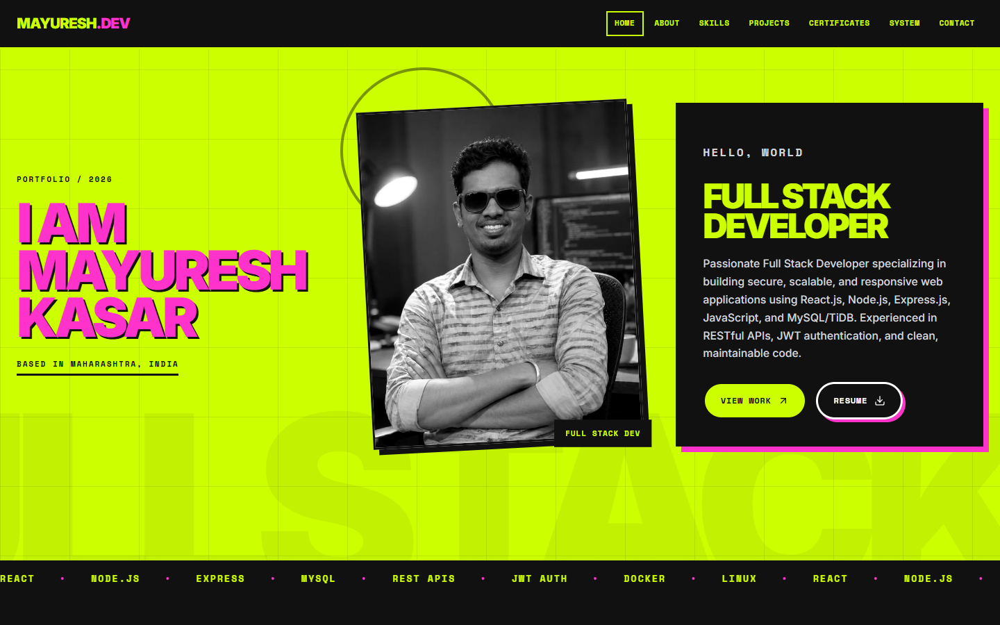 | 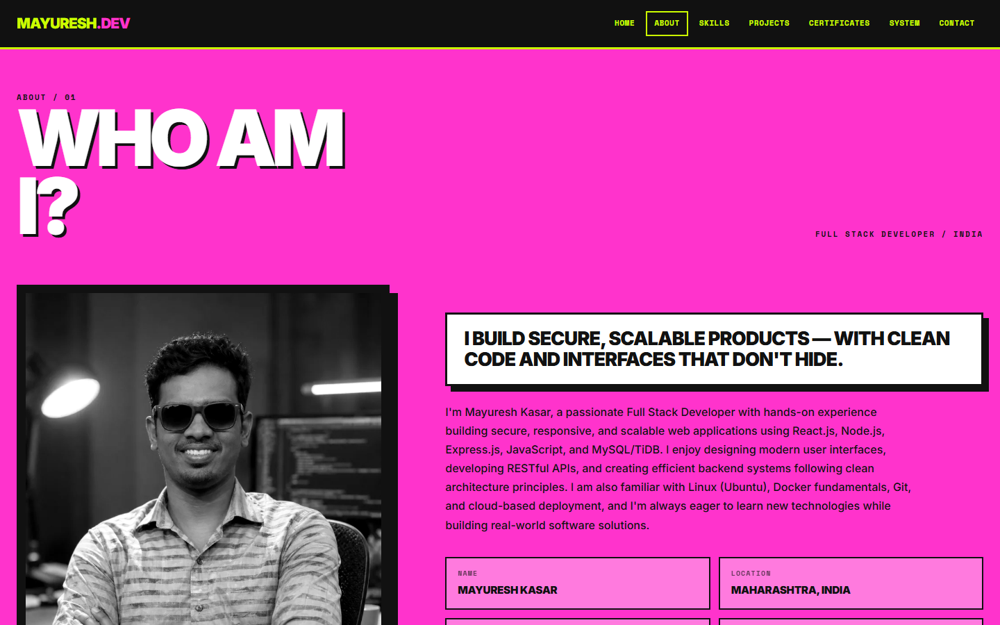 | 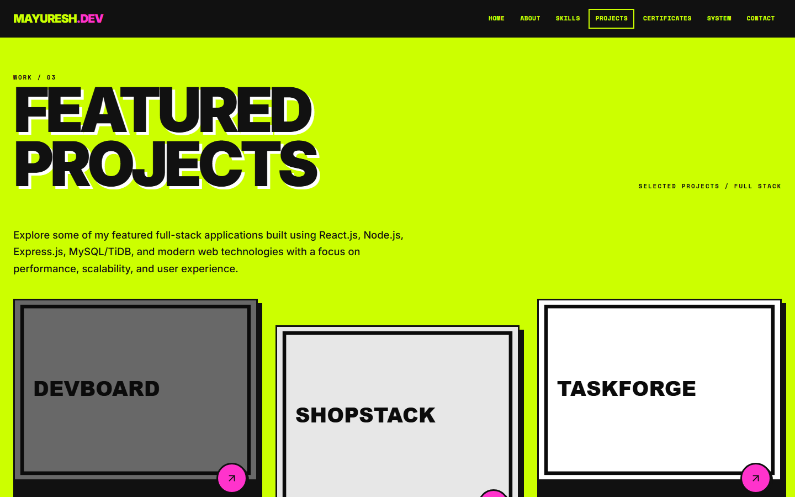 |

| Skills | Certificates | Contact |
|:---:|:---:|:---:|
| 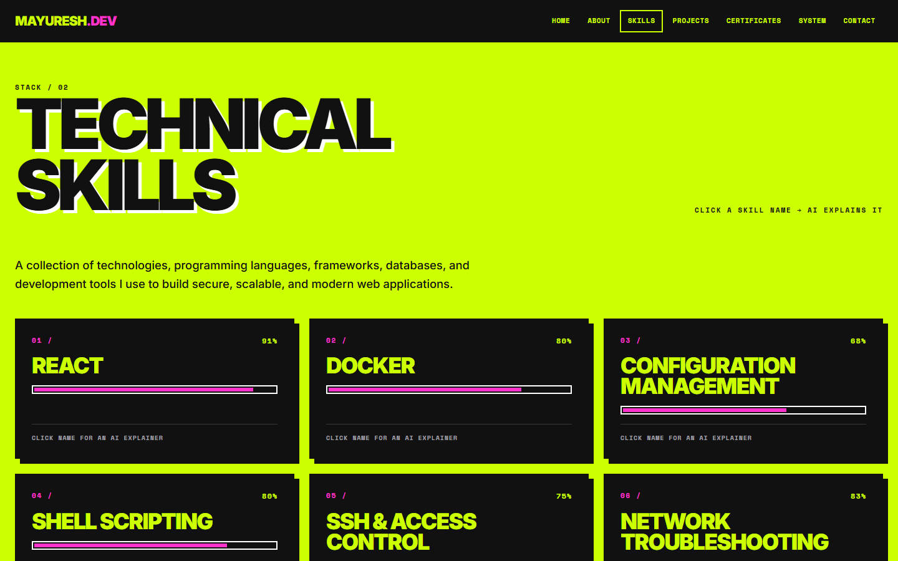 | 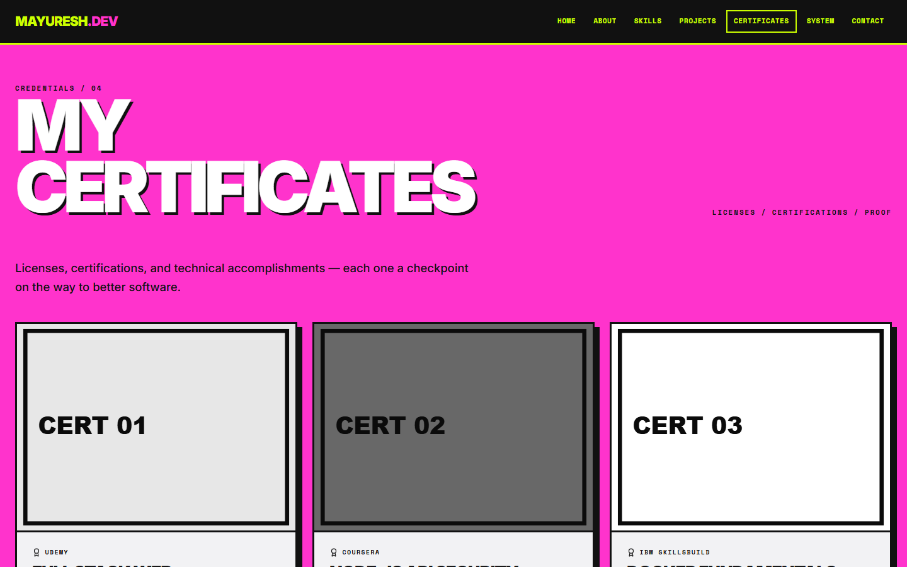 | 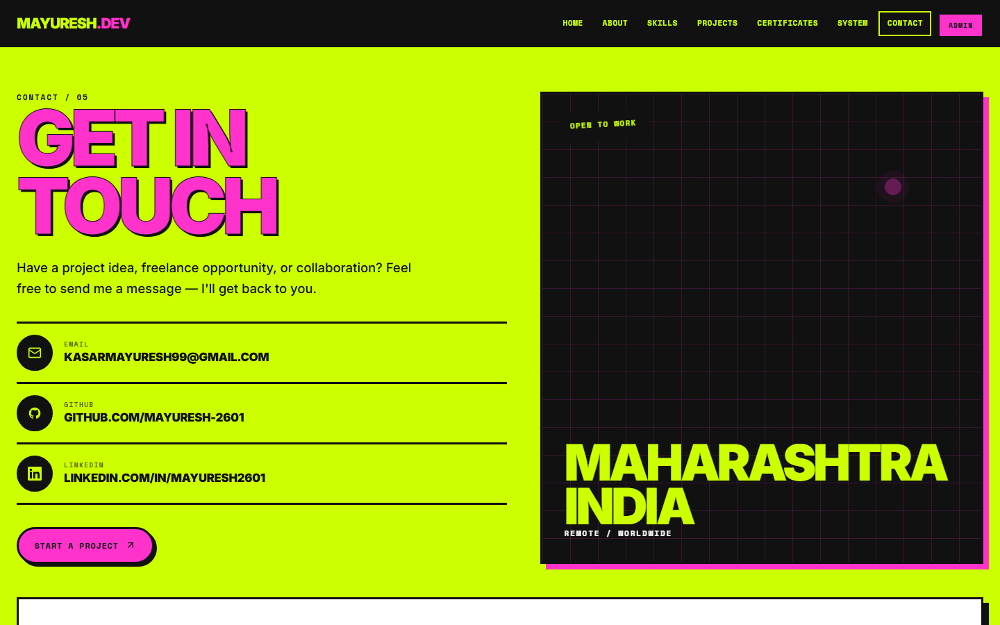 |

| Live System | Blog Index | Blog Post |
|:---:|:---:|:---:|
| 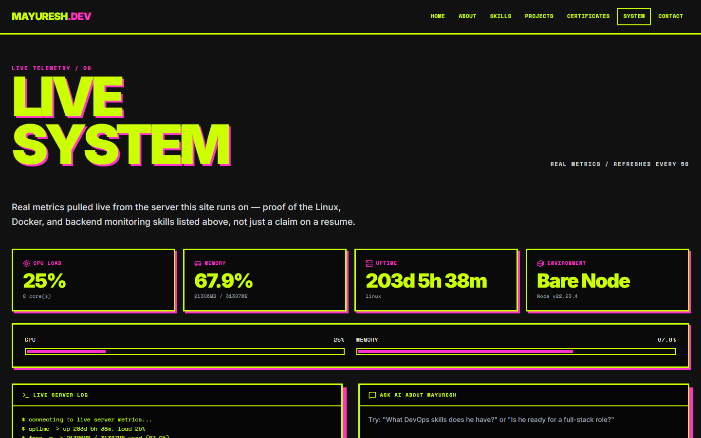 | 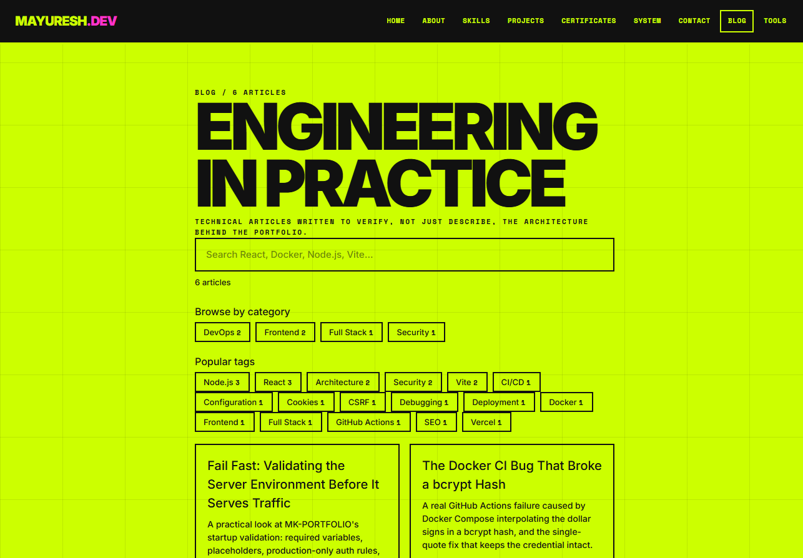 | 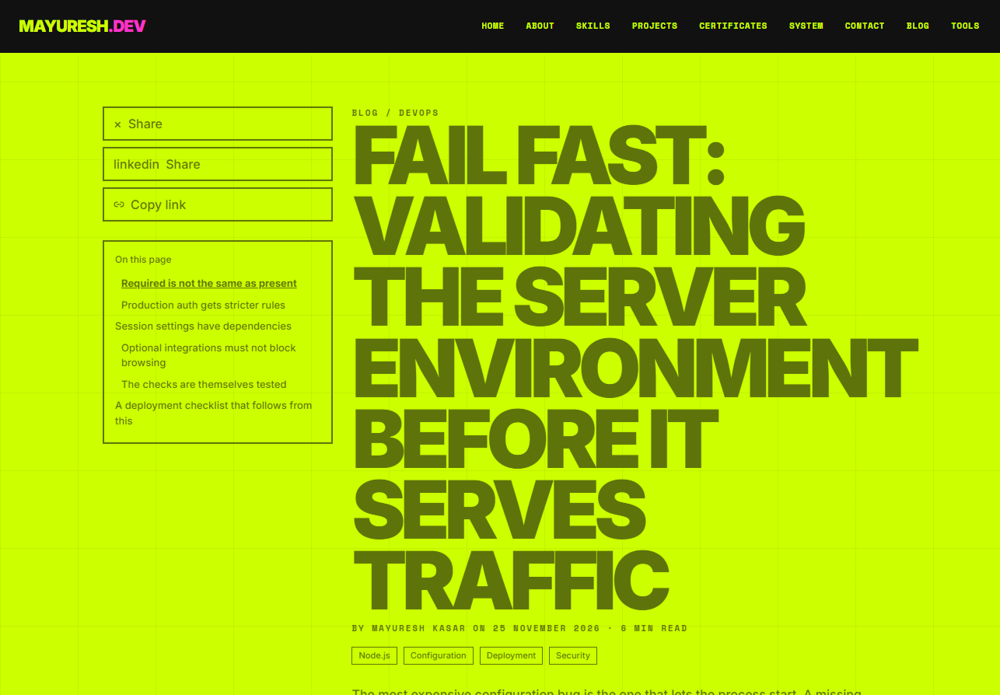 |

### Admin Area

| Login | Dashboard |
|:---:|:---:|
| 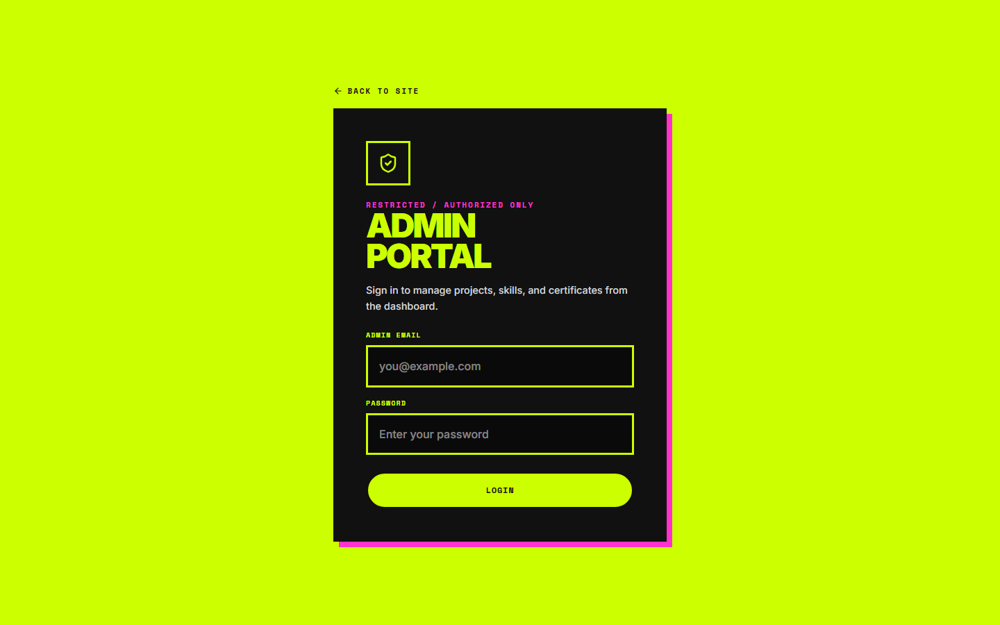 | 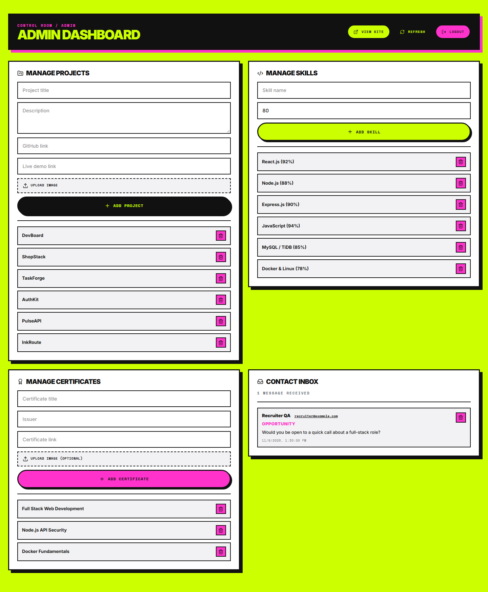 |

### Developer Tools

| Tools Index | JWT Decoder | Contrast Checker |
|:---:|:---:|:---:|
| 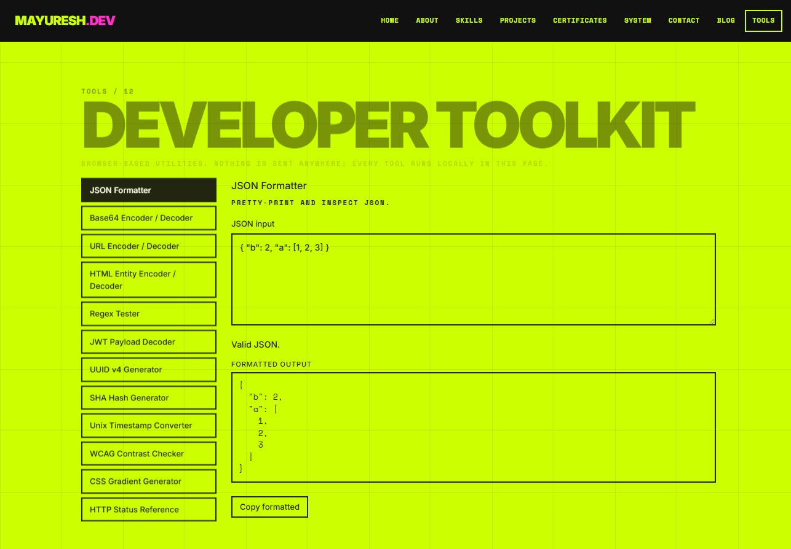 | 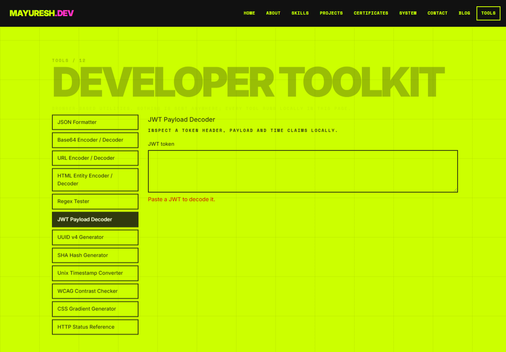 | 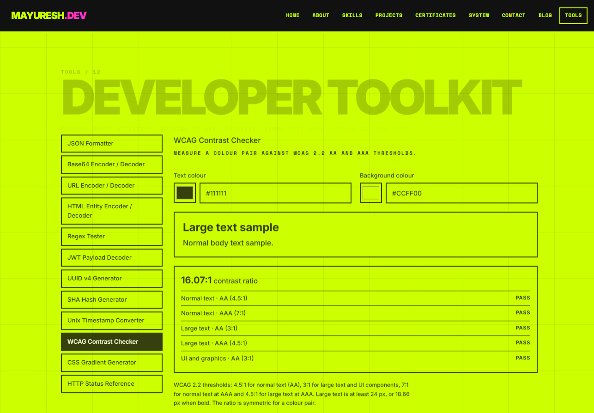 |

---

## 📝 Technical Blog

**6 dependency-free articles** — structured JavaScript content blocks rendered to safe React elements; no Markdown parser, no `dangerouslySetInnerHTML`. Each article is grounded in this repository's actual implementation.

| # | Article | Category | Description | Live Link |
|---|---|---|---|---|
| 1 | **How I Built My Full-Stack Developer Portfolio** | Full Stack | Architecture decisions: React+Vite, Express+MySQL, Docker, CI/CD, cookie sessions | [📖 Read](https://mk-portfolio-phi-silk.vercel.app/blog/how-i-built-my-full-stack-developer-portfolio) |
| 2 | **React and Vite Architecture for a Portfolio SPA** | Frontend | Self-hosted fonts, code splitting, React Router 7, Tailwind 4, SEO route documents | [📖 Read](https://mk-portfolio-phi-silk.vercel.app/blog/react-and-vite-architecture-for-a-portfolio-spa) |
| 3 | **The Docker CI Bug That Broke a bcrypt Hash** | DevOps | How Docker Compose interpolated `$` in a bcrypt hash, the single-quote fix, and CI hardening | [📖 Read](https://mk-portfolio-phi-silk.vercel.app/blog/docker-compose-bcrypt-hash-ci-failure) |
| 4 | **Cookie Sessions Without the JWT Tax** | Security | HttpOnly cookie, SHA-256 token hash in MySQL, absolute/idle timeouts, per-session CSRF | [📖 Read](https://mk-portfolio-phi-silk.vercel.app/blog/cookie-sessions-without-jwt-localstorage) |
| 5 | **Static SEO Documents and Real 404s in a React SPA** | Frontend | Vite build writes route-specific HTML; Vercel cleanUrls + `404.html` = real HTTP 404s | [📖 Read](https://mk-portfolio-phi-silk.vercel.app/blog/static-seo-and-real-404s-in-a-react-spa) |
| 6 | **Fail Fast: Validating the Server Environment Before It Serves Traffic** | DevOps | Startup validation: required vars, placeholder detection, auth rules, session bounds, optional integrations | [📖 Read](https://mk-portfolio-phi-silk.vercel.app/blog/fail-fast-environment-validation) |

### Blog Features

- **Taxonomy & Search** — Tag/category pages use slug matching; search scoped to current taxonomy
- **Reading Tools** — Sticky TOC, social share (X/LinkedIn/copy), related articles, author card
- **SEO-First** — Per-article JSON-LD Article, Open Graph, Twitter cards, canonical, `sitemap.xml`, `rss.xml`
- **Real 404s** — Unknown slugs return HTTP 404 with `noindex`, not a soft 200
- **Accessibility** — Semantic headings, `aria-current` on active taxonomy, skip links, reduced motion

### Blog in Action

| Index with taxonomy & search | Article with sticky TOC |
|:---:|:---:|
|  |  |

---

## 🛠 Developer Tools

**12 browser-based utilities** — everything runs **locally in your browser**; nothing is sent to a server, no tokens transmitted.

| Tool | Description | Key Features |
|:---|:---|:---|
| **JSON Formatter** | Pretty-print & validate | Syntax highlight, error location, copy formatted |
| **Base64 Encoder/Decoder** | UTF-8 safe | Encode/decode, Unicode emoji support |
| **URL Encoder/Decoder** | Percent-encoding | Query strings, paths, full URLs |
| **HTML Entity Encoder/Decoder** | Escape `& < > " '` | Round-trip safe, entity map |
| **Regex Tester** | Live matching | Flags, groups, zero-width safety, match index |
| **JWT Payload Decoder** | Inspect header/payload | **Shows `iat`/`nbf`/`exp` + expiry state**, no signature verification |
| **UUID v4 Generator** | RFC 4122 v4 | `crypto.getRandomValues`, version/variant bits set |
| **SHA Hash Generator** | SHA-256/384/512 | Web Crypto API, test vectors included, password warning |
| **Unix Timestamp Converter** | Seconds/ms/ISO 8601 | Auto-detect unit, UTC + local time, RFC 822 |
| **WCAG Contrast Checker** | 2.2 AA/AAA | Ratio + pass/fail for normal/large text & UI, live preview |
| **CSS Gradient Generator** | Linear/radial | Angle, stops, named colors + hex, copyable CSS |
| **HTTP Status Reference** | Code lookup | Category, label, search by code/name |

### Tool Security Model

- **No network calls** — all logic in `client/src/lib/devtools.js` pure functions
- **JWT decoder warns** — "Does not verify signature; do not trust for auth"
- **Hash ≠ password storage** — UI states: "Use bcrypt/scrypt/Argon2 for passwords"
- **Tested** — 38 client tests covering edge cases, malformed input, large payloads

### Tools in Action

| All 12 tools | JWT decoder (expiry) | WCAG contrast checker |
|:---:|:---:|:---:|
|  |  |  |

---

## ✨ Feature Highlights

### 🌐 Public Portfolio
- **12 public routes** — Home, About, Skills, Projects, Certificates, System, Contact, Blog, Tools, Privacy, Terms, Accessibility
- **Database-driven** — All content from API, not hardcoded arrays
- **Shareable pagination** — `?page=` in URL for Projects/Skills/Certificates
- **Kinetic Brutalism** — Acid/ink/pink palette, hard borders, offset shadows, marquee, count-up, scroll reveals
- **Responsive** — Desktop/tablet/mobile with full-screen menu
- **Accessibility** — Skip link, semantic landmarks, keyboard traps, visible focus, `prefers-reduced-motion`
- **SEO Complete** — Route docs, JSON-LD, OG/Twitter, sitemap, RSS, llms.txt, robots, security.txt, manifest
- **Real 404s** — `404.html` with HTTP 404 + `noindex`, not soft 200
- **Self-hosted fonts** — Inter + Space Mono via Fontsource, zero Google Fonts requests

### 🤖 AI-Powered Explanations
- **Explain Skill** — Click any skill → Gemini explains it in plain language
- **Explain Certificate** — What the cert covers, why it matters
- **Ask AI About Me** — Chat on `/system`: "What DevOps skills does he have?"
- **Graceful failure** — Missing key = `502`, page stays usable
- **Rate limited** — 10 req/min/IP per AI endpoint

### 📊 Live System Panel (`/system`)
- **Real telemetry** — CPU load %, memory %, uptime, AI status, deployment commit
- **5-second refresh** — Polls live API while open
- **Terminal log** — Appends metric lines as they arrive
- **Dedicated rate limit** — 120 req/min (separate from general API)
- **Public by design** — Recruiters see the running backend, not a claim

### 🔐 Admin Dashboard
- **Cookie-session login** — HttpOnly, Secure, SameSite=Lax, optional TOTP
- **Full CRUD** — Projects, Skills, Certificates with Cloudinary uploads
- **Contact inbox** — Read/delete messages, message-first design
- **Immediate feedback** — Success/error states, manual refresh
- **Protected routes** — Redirects to `/admin` on missing/invalid session

### 📬 Contact & Notifications
- **Validated form** — Name, email, subject, message (server-side)
- **Message-first** — Saved to DB **before** email attempt
- **Gmail API** — HTTPS delivery works on Render free tier
- **Spam protection** — 5 submissions/15 min/IP

---

## 🏗 Tech Stack

| Layer | Technology | Version | Why |
|:---|:---|:---|:---|
| **UI Framework** | React | 18 | Component model, concurrent features |
| **Router** | React Router | 7 | Client-side routing, data loaders |
| **Build Tool** | Vite | 6 | Fast HMR, optimized production builds |
| **Styling** | Tailwind CSS + Custom | 4 | Utility workflow + Kinetic Brutalism design system |
| **HTTP Client** | Axios | 1.15 | Interceptors, timeout, retry |
| **Icons** | Lucide React | 1.11 | Consistent, accessible, tree-shakeable |
| **Fonts** | Fontsource | 5.3 | Self-hosted Inter + Space Mono |
| **Runtime** | Node.js | 22 LTS | Modern async, native test runner |
| **API Framework** | Express | 5 | Lightweight, modern middleware |
| **Database** | MySQL2 + TiDB | 8.0 | Relational, TLS, connection pooling |
| **Auth** | bcryptjs | 3.0 | Production hash; timing-safe fallback |
| **Security** | Helmet, CORS, express-rate-limit | Latest | Headers, origin allowlist, abuse limits |
| **Uploads** | Multer + Cloudinary | Latest | Memory-buffered, 5 MB limit |
| **Email** | Nodemailer + Gmail API | Latest | HTTPS delivery on Render |
| **AI** | Google Gemini | 1.5 Flash Lite | On-demand explanations |
| **Local Runtime** | Docker Compose | v2 | Reproducible full-stack env |
| **CI/CD** | GitHub Actions | Latest | 7 jobs: lint, test, build, deploy, smoke |
| **Hosting** | Vercel, Render, TiDB | Managed | Static frontend, Node API, managed DB |

---

## 🏛 Architecture

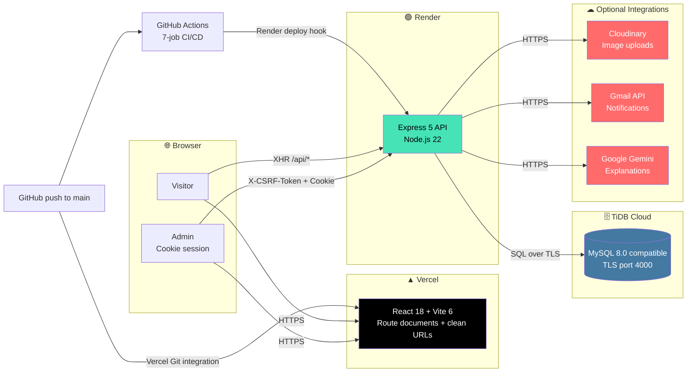

### Request Flow

1. **Vercel** serves route-specific static document (e.g., `about/index.html`) with clean URLs; unknown paths → `404.html`
2. **Browser** hydrates React app, calls same-origin `/api`; Vercel rewrites to Render
3. **Express** applies CORS, Helmet, JSON parsing, rate limiting, route handlers; state-changing requests require `X-CSRF-Token` + exact Origin/Referer
4. **Public reads** from TiDB; **admin writes** use cookie-based session (no Bearer token)
5. **Contact messages** inserted first → Gmail notification attempted; attachment via Cloudinary → deleted after send
6. **`/api/system`** reads live process/host metrics from Node.js

### Local Docker Architecture

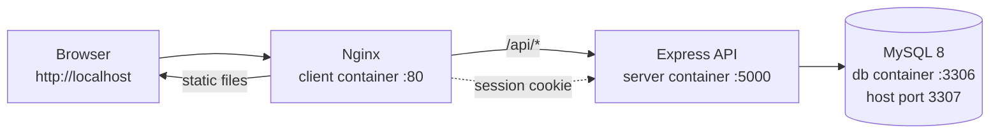

---

## 📁 Project Structure

```text
MK-PORTFOLIO/
├── client/                     # React + Vite frontend
│   ├── public/                 # Resume, profile images, robots.txt, manifest, security.txt
│   ├── scripts/build-seo.mjs   # Route docs, sitemap, RSS, llms.txt, 404.html
│   ├── src/
│   │   ├── api/                # Axios instance, CSRF handling, 401 redirect
│   │   ├── components/         # Navbar, Footer, SEO, Legal, AI Modal, Stats
│   │   ├── content/posts/      # Structured blog content blocks (6 articles)
│   │   ├── hooks/              # useScrollReveal, usePaginatedList
│   │   ├── lib/                # Blog, taxonomy, analytics, devtools
│   │   ├── pages/public/       # 12 public pages + blog + policies
│   │   ├── pages/tools/        # 12 developer tools
│   │   ├── pages/admin/        # AdminLogin, AdminDashboard
│   │   ├── utils/              # safeExternalUrl
│   │   ├── index.css           # Design system + Kinetic Brutalism
│   │   ├── index.content.css   # Blog, tools, legal, admin styles
│   │   ├── App.jsx             # Routes, skip link, nav/footer visibility
│   │   └── main.jsx            # Entry point, fonts, router
│   ├── tests/                  # 38 client unit tests
│   ├── Dockerfile              # Multi-stage Node build → Nginx
│   ├── nginx.conf              # SPA routing, CSP, gzip, /api proxy
│   ├── vercel.json             # Clean URLs, security headers, /api rewrite
│   └── vite.config.js          # Dev/preview proxy config
├── server/                     # Express API
│   ├── config/                 # DB, Cloudinary, email, env validation
│   ├── controllers/            # Projects, skills, certificates, messages, auth, AI, system
│   ├── database/               # schema.sql, seed.sql, database Dockerfile
│   ├── middleware/             # Auth, uploads, rate limits, errors
│   ├── routes/                 # REST route definitions
│   ├── scripts/                # DB lifecycle, hash, Gmail auth, email tests
│   ├── services/               # Gemini integration
│   ├── tests/                  # 119 server unit tests
│   ├── utils/                  # sessionState, sessionConfig, adminAuth, security
│   ├── Dockerfile              # Production API image
│   └── server.js               # Bootstrap, graceful shutdown
├── docs/                       # Screenshots + operational docs
├── AUDIT/                      # Growth, security, run reports
├── .github/workflows/          # 7-job CI/CD pipeline
├── docker-compose.yml          # Full local stack
├── render.yaml                 # Render blueprint
├── .env.example                # Docker Compose values (local only)
└── README.md
```

---

## 🚀 Quick Start

### Prerequisites

| Requirement | Version |
|:---|:---|
| Node.js | 22.x (see `.nvmrc`) |
| npm | 10+ |
| Git | Any recent version |
| MySQL | 8.0+ or TiDB Cloud cluster |
| Docker | Optional (for all-in-one stack) |

### 1. Clone & Configure API

```bash
git clone https://github.com/mayuresh-2601/MK-PORTFOLIO.git
cd MK-PORTFOLIO/server
npm ci

# Windows PowerShell
Copy-Item .env.example .env
# macOS/Linux
cp .env.example .env
```

Set minimum values in `server/.env`:

```env
DB_HOST=your-tidb-host
DB_PORT=4000
DB_USER=your-db-user
DB_PASSWORD=your-db-password
DB_NAME=portfolio
DB_SSL=true

ADMIN_EMAIL=your-admin@example.com
# Local dev only — production rejects this:
ADMIN_PASSWORD='replace-with-a-long-unique-password'
# Production requires bcrypt hash:
# npm run hash-password -- "your-password"
# then set ADMIN_PASSWORD_HASH and remove ADMIN_PASSWORD
```

### 2. Create Schema & Seed Data

```bash
npm run db:setup
npm run db:seed
npm run db:check
```

### 3. Start API Dev Server

```bash
npm run dev
# Verify: curl http://localhost:5000/api/health
```

### 4. Configure & Start Client

```bash
cd ../client
npm ci

# Windows
Copy-Item .env.example .env
# macOS/Linux
cp .env.example .env

npm run dev
```

Open <http://localhost:5173> — Admin at <http://localhost:5173/admin>

> The client **always calls same-origin `/api`**. Vite proxies to `VITE_PROXY_TARGET` (`http://localhost:5000`) during dev. **Do not set a cross-site API origin.**

### 5. Quality Checks

```bash
# Frontend
cd client
npm test          # 38 tests
npm run lint      # ESLint
npm run build     # Production build + route docs + sitemap + RSS + llms.txt

# Backend
cd ../server
npm run check     # Syntax check
npm test          # 119 tests
npm run db:check  # Verify schema & counts
```

### Docker Alternative

```bash
# From repository root
Copy-Item .env.example .env
Copy-Item server/.env.example server/.env
# Set ADMIN_PASSWORD_HASH + ADMIN_EMAIL in server/.env
docker compose up --build -d

# Open http://localhost | API: http://localhost:5000/api/health
```

---

## ⚙ Environment Variables

**Three separate env files** — keeps server secrets out of the browser bundle.

| File | Purpose | Committed? |
|:---|:---|:---|
| `.env` (root) | Docker Compose DB values only | ❌ Use `.env.example` |
| `client/.env` | Public Vite variables | ❌ Use `client/.env.example` |
| `server/.env` | API, DB, auth, email, upload, AI secrets | ❌ Use `server/.env.example` |

> **Never commit a real `.env` file.** CI fails if env files or build output are tracked.

### Production Placement

| Variable Group | Local Dev | Local Docker | Render API | Vercel Frontend |
|:---|:---|:---|:---|:---|
| `DB_*` | `server/.env` | Root `.env` + Compose | Render Environment | — |
| `ADMIN_*` | `server/.env` | `server/.env` | Render Environment | — |
| Gmail | `server/.env` | `server/.env` | Render Environment | — |
| Cloudinary | `server/.env` | `server/.env` | Render Environment | — |
| `GEMINI_API_KEY` | `server/.env` | `server/.env` | Render Environment | — |

> The browser **always calls same-origin `/api`**. Vercel rewrites to Render, keeping the session cookie first-party. **No public API-origin variable in Vercel.**

### Key Server Variables

| Variable | Required | Description |
|:---|:---|:---|
| `CLIENT_URL` | ✅ | Comma-separated allowed origins (no trailing slash) |
| `DB_HOST` / `DB_PORT` / `DB_USER` / `DB_PASSWORD` / `DB_NAME` / `DB_SSL` | ✅ | TiDB Cloud (port 4000, SSL) or local MySQL |
| `ADMIN_EMAIL` | ✅ | Single admin email |
| `ADMIN_PASSWORD_HASH` | ✅ (prod) | bcrypt from `npm run hash-password` |
| `ADMIN_PASSWORD` | Local only | 12+ chars; **rejected in production** |
| `ADMIN_TOTP_SECRET` | Optional | Base32; enables MFA at login |
| `SESSION_TTL_MINUTES` | Optional | 5–1440, default 120 |
| `SESSION_IDLE_MINUTES` | Optional | 5–1440, ≤ TTL, default 30 |
| `EMAIL_TRANSPORT` | Optional | `auto`, `gmail-api`, `smtp`, `none` |
| `GEMINI_API_KEY` | Optional | AI endpoints return `502` until set |

---

## 📧 Email Notifications

Contact messages **always saved to DB first**. Email = best-effort notification.

> **Render free tier blocks outbound SMTP (ports 25/465/587). Use Gmail API over HTTPS.**

### Gmail API Setup

1. [Google Cloud Console](https://console.cloud.google.com/) → Create project
2. Enable **Gmail API**
3. OAuth consent screen → **External** → Add test user → Scopes:
   - `openid`
   - `email`
   - `https://www.googleapis.com/auth/gmail.send`
4. Publishing status → **In production** (testing mode expires refresh tokens in 7 days)
5. Credentials → **OAuth client ID** → **Desktop app** → Copy ID + Secret
6. Add to `server/.env`:

```env
EMAIL_USER=your-address@gmail.com
GMAIL_CLIENT_ID=your-client-id.apps.googleusercontent.com
GMAIL_CLIENT_SECRET=GOCSPX-your-client-secret
EMAIL_TRANSPORT=auto
```

7. Run one-time auth:

```bash
cd server && npm run gmail:auth
# Browser opens → approve → writes GMAIL_REFRESH_TOKEN to .env
```

8. Verify & test:

```bash
npm run email:check  # Validates config
npm run email:test   # Sends real email to ADMIN_EMAIL
```

### Render Environment

Add in Render Dashboard → `mk-portfolio-api` → Environment:

| Key | Value |
|:---|:---|
| `EMAIL_USER` | Your Gmail address |
| `GMAIL_CLIENT_ID` | OAuth Desktop client ID |
| `GMAIL_CLIENT_SECRET` | OAuth Desktop client secret |
| `GMAIL_REFRESH_TOKEN` | From `npm run gmail:auth` |
| `EMAIL_TRANSPORT` | `gmail-api` |

---

## ☁ Optional Integrations

### Cloudinary (Image Uploads)

```env
CLOUD_NAME=your-cloud-name
CLOUD_API_KEY=your-api-key
CLOUD_API_SECRET=your-api-secret
```
Upload endpoints return `503` until configured. Core site works without it.

### Google Gemini (AI Explanations)

```env
GEMINI_API_KEY=your-gemini-key
```
Get key from [Google AI Studio](https://aistudio.google.com/app/apikey). AI endpoints return `502` until set.

---

## 🐳 Docker

### Services

| Service | Image | Host Port | Purpose |
|:---|:---|:---|:---|
| `client` | Multi-stage Node → Nginx | 80 | React build + `/api` proxy |
| `server` | Node 22 Alpine | 5000 | Express API |
| `db` | MySQL 8 (baked schema) | 3307 | Local DB; internal 3306 |

### Start Stack

```bash
# 1. Root env
Copy-Item .env.example .env

# 2. Server env (set ADMIN_PASSWORD_HASH + ADMIN_EMAIL)
Copy-Item server/.env.example server/.env

# 3. Build & start
docker compose up --build -d

# 4. Verify
# Site: http://localhost
# API health: http://localhost:5000/api/health
# API ready:  http://localhost:5000/api/health/ready
# MySQL:      localhost:3307
```

### Useful Commands

```bash
docker compose ps
docker compose logs -f server
docker compose logs -f db
docker compose down
docker compose down -v  # Reset DB volume
```

> **Why SQL is baked:** Earlier versions bind-mounted `schema.sql`/`seed.sql`. On Windows Docker Desktop, FAT32 drives can appear as empty dirs in containers. Now both files are `COPY`ed at build time — works from USB drive.

---

## 📚 API Reference

### Base URLs

| Environment | Base URL |
|:---|:---|
| Production | `https://mk-portfolio-api.onrender.com` |
| Local | `http://localhost:5000` |
| Docker | `http://localhost:5000` (or same-origin `/api` via Nginx) |

### Health

| Method | Endpoint | Auth | Description |
|:---|:---|:---|:---|
| `GET` | `/` | Public | Service metadata & environment |
| `GET` | `/api/health` | Public | Liveness check, uptime |
| `GET` | `/api/health/ready` | Public | Readiness: verifies DB with `SELECT 1` |

### Authentication

| Method | Endpoint | Auth | Description |
|:---|:---|:---|:---|
| `POST` | `/api/auth/login` | Public | Email/password → cookie session |

**Login Request:**
```bash
curl -X POST https://mk-portfolio-api.onrender.com/api/auth/login \
  -H "Content-Type: application/json" \
  -d '{"email":"admin@example.com","password":"<your-password>"}'
```

**Response:**
```json
{
  "success": true,
  "message": "Login successful.",
  "csrfToken": "<64-hex-chars>",
  "expiresAt": 1760000000000,
  "mfaEnabled": false,
  "user": { "email": "admin@example.com", "role": "admin" }
}
```
- Sets HttpOnly, Secure (prod), SameSite=Lax cookie: `__Host-portfolio_session`
- State-changing requests require `X-CSRF-Token` header + exact Origin/Referer

**Logout:**
```bash
curl -X POST https://mk-portfolio-api.onrender.com/api/auth/logout \
  -H "Origin: https://mk-portfolio-phi-silk.vercel.app" \
  -H "X-CSRF-Token: <your-csrf-token>"
```

**Logout All Sessions:**
```bash
curl -X POST https://mk-portfolio-api.onrender.com/api/auth/logout-all \
  -H "Origin: https://mk-portfolio-phi-silk.vercel.app" \
  -H "X-CSRF-Token: <your-csrf-token>"
```

### Portfolio Content

| Method | Endpoint | Auth | Description |
|:---|:---|:---|:---|
| `GET` | `/api/projects` | Public | List projects (paginated) |
| `POST` | `/api/projects` | Admin | Create (multipart image) |
| `PUT` | `/api/projects/:id` | Admin | Update |
| `DELETE` | `/api/projects/:id` | Admin | Delete |
| `GET` | `/api/skills` | Public | List skills (paginated) |
| `POST` | `/api/skills` | Admin | Create |
| `PUT` | `/api/skills/:id` | Admin | Update |
| `DELETE` | `/api/skills/:id` | Admin | Delete |
| `GET` | `/api/certificates` | Public | List certificates (paginated) |
| `POST` | `/api/certificates` | Admin | Create (multipart image) |
| `PUT` | `/api/certificates/:id` | Admin | Update |
| `DELETE` | `/api/certificates/:id` | Admin | Delete |

### Contact Messages

| Method | Endpoint | Auth | Description |
|:---|:---|:---|:---|
| `POST` | `/api/messages` | Public | Submit contact message |
| `GET` | `/api/messages` | Admin | Read inbox |
| `DELETE` | `/api/messages/:id` | Admin | Delete message |

### AI Endpoints

| Method | Endpoint | Auth | Description |
|:---|:---|:---|:---|
| `POST` | `/api/ai/explain-skill` | Public | Explain a skill |
| `POST` | `/api/ai/explain-certificate` | Public | Explain a certificate |
| `POST` | `/api/ai/ask-about-me` | Public | Portfolio Q&A (max 300 chars) |

### System

| Method | Endpoint | Auth | Description |
|:---|:---|:---|:---|
| `GET` | `/api/system` | Public | CPU, memory, uptime, AI status, deploy commit |

### Rate Limits

| Scope | Limit |
|:---|:---|
| General `/api/*` | 300 req / 15 min / IP |
| `/api/system` | 120 req / min / IP |
| `POST /api/auth/login` | 10 failed / 15 min / IP |
| `POST /api/messages` | 5 / 15 min / IP |
| `/api/ai/*` | 10 req / min / IP |

> Health endpoints excluded from general limiter.

---

## 🗄 Database

### Schema

| Table | Purpose |
|:---|:---|
| `projects` | Title, description, GitHub URL, demo URL, image |
| `skills` | Name, proficiency level (0–100) |
| `certificates` | Title, issuer, date, credential URL, image |
| `messages` | Contact form submissions |
| `admin_sessions` | Opaque sessions: token hash, CSRF, expiry, revocation |

All tables: `utf8mb4` + `utf8mb4_unicode_ci`. SQL in `server/database/schema.sql`, seed in `seed.sql`.

### Commands (from `server/`)

```bash
npm run db:setup     # Create DB + apply schema
npm run db:seed      # Load baseline content
npm run db:migrate   # Idempotent upgrade for existing DB
npm run db:check     # Verify tables, columns, charset, counts
```

### Production (TiDB Cloud)

- Port `4000`, TLS (`DB_SSL=true`)
- Database `portfolio` (or your `DB_NAME`)
- Allow Render outbound connections
- Run `db:setup` + `db:seed` once, then `db:check`

---

## 🔄 CI/CD Pipeline

**Workflow:** `.github/workflows/docker-ci.yml` — runs on every push/PR to `main` + manual dispatch.

| # | Job | Verifies |
|:---|:---|:---|
| 1 | **Repository Hygiene** | No `.env`, secrets, `node_modules`, `dist`, build output tracked |
| 2 | **Server Syntax & Tests** | Node syntax + 119 server tests |
| 3 | **Client Tests, Lint & Build** | 38 client tests + ESLint + production build (42 route docs, 39 sitemap URLs) |
| 4 | **Lint Dockerfiles** | Hadolint on all 3 Dockerfiles |
| 5 | **Build & Test Full Stack** | Compose stack up, MySQL/API/Nginx, schema/seed, API/auth/update tests |
| 6 | **Deploy API to Render** | Triggers deploy hook, waits for `/api/system` to report commit live |
| 7 | **Production Smoke Tests** | Render health/ready, public endpoints, CORS, admin auth, Vercel routes, security headers, robots/sitemap/RSS/llms/404 |

> Docker job also proves SQL is DB-name independent by applying to `portfolio_alt` and checking row counts.

### Required GitHub Secret

| Name | Type | Purpose |
|:---|:---|:---|
| `RENDER_DEPLOY_HOOK_URL` | Secret | Render deploy hook |

### Optional Repository Variables

| Name | Default |
|:---|:---|
| `PRODUCTION_API_URL` | `https://mk-portfolio-api.onrender.com` |
| `PRODUCTION_SITE_URL` | `https://mk-portfolio-phi-silk.vercel.app` |

> Render `autoDeploy: false` in `render.yaml`. Deploys **only after CI passes**.

---

## 🚢 Deployment

### Frontend → Vercel

1. Import repo → **Root Directory: `client`**
2. Framework: **Vite**
3. Build: `npm run build` | Output: `dist`
4. **No API-origin variable** — `client/vercel.json` rewrites `/api` to Render
5. Deploy — `vercel.json` provides clean URLs, security headers, asset caching, `/api` rewrite; `build-seo.mjs` generates route docs, sitemap, RSS, llms.txt, 404

### API → Render

1. **Web Service** from repo → Root: `server`
2. Build: `npm ci` | Start: `npm start` | Health: `/api/health`
3. Add variables from `server/.env.example`:
   - `DB_HOST`, `DB_PORT`, `DB_USER`, `DB_PASSWORD`, `DB_NAME`, `DB_SSL`
   - `ADMIN_PASSWORD_HASH` (required), `ADMIN_EMAIL`, `CLIENT_URL`
   - Optional: Cloudinary, Gmail API, Gemini
4. Deploy — CI triggers subsequent deploys after green pipeline

> `render.yaml` included as blueprint.

### Database → TiDB Cloud

1. Create Starter/Dedicated cluster
2. Create DB user + allow Render connections
3. Copy host, port `4000`, user, password, DB name
4. Set `DB_SSL=true`
5. Run `npm run db:setup` + `db:seed` against prod values
6. Verify `npm run db:check`

### Order

```text
TiDB Cloud → Render API → Vercel Frontend → GitHub Actions smoke tests
```

---

## 🔒 Security

- **One admin identity** — exact `ADMIN_EMAIL` + `ADMIN_PASSWORD_HASH` in production; plain `ADMIN_PASSWORD` rejected at startup & login
- **Timing-safe checks** — bcrypt in prod; local fallback SHA-256 + `crypto.timingSafeEqual`
- **Cookie-session auth** — opaque random token in HttpOnly cookie; only SHA-256 hash in DB; optional TOTP via `ADMIN_TOTP_SECRET`
- **Login throttling** — 10 failed attempts / 15 min / resolved IP
- **CORS allowlist** — `CLIENT_URL` exact production origins; Vercel previews opt-in via `ALLOW_VERCEL_PREVIEWS`
- **Security headers** — Helmet (API); CSP, HSTS, `X-Frame-Options: DENY`, `X-Content-Type-Options: nosniff`, restrictive permissions policy (frontend)
- **Input validation** — required fields, type checks, email format, length limits, `400` for malformed JSON
- **Upload controls** — MIME allowlist, 5 MB limit, 1 file/req, in-memory buffer before Cloudinary
- **No secrets in client** — only `VITE_*` public; passwords, session hashes, refresh tokens, API keys server-side
- **No secrets in images** — `.dockerignore` + CI keep `.env`/build output out of containers
- **Graceful failure** — optional integrations return `503`/`502` without taking down core site
- **Environment validation** — prod startup fails fast if required values missing or placeholders

> Found a security issue? Open a private GitHub report or contact maintainer — **no public exploits.**

---

## 🩺 Troubleshooting

| Symptom | Likely Cause | Fix |
|:---|:---|:---|
| First request 30–60s | Render free tier waking | Wait; frontend timeout 60s |
| CORS error | `CLIENT_URL` mismatch | Add exact Vercel origin (no trailing slash), redeploy Render |
| `503` image upload | Cloudinary not configured | Add `CLOUD_NAME`, `CLOUD_API_KEY`, `CLOUD_API_SECRET` |
| Message saved, no email | Gmail vars missing/invalid | Follow [Email Notifications](#email-notifications), check Render logs |
| `Email not configured` in logs | Expected without 5 Gmail vars | Configure Gmail API; messages still saved |
| API can't connect TiDB | Wrong port/SSL/creds | Port `4000`, `DB_SSL=true`, verify TiDB user |
| Admin login `401` | Email/hash mismatch | Check `ADMIN_EMAIL` + `ADMIN_PASSWORD_HASH`; plain password rejected in prod |
| API refuses start: plain password | `ADMIN_PASSWORD` set in prod | Generate hash, set `ADMIN_PASSWORD_HASH`, remove `ADMIN_PASSWORD` |
| Local calls Render API | Custom build bakes cross-site URL | Remove API-origin var; client uses same-origin `/api` |
| Docker MySQL no tables | Old image/existing volume | `docker compose build --no-cache db` then `docker compose down -v` |
| Docker daemon not found | Docker Desktop stopped | Start Docker Desktop |
| AI `502` | `GEMINI_API_KEY` missing/invalid | Add valid key in API env |
| Broken images | Cloudinary upload failed | Check API logs, re-upload after config |
| `npm ci` fails | Lockfile/package.json mismatch or wrong Node | Use Node 22, run `npm install` |

### Checking Production Logs

```bash
# Render Dashboard → mk-portfolio-api → Logs
# Look for:
#   Database connected successfully
#   API listening on 0.0.0.0:10000
#   Email transport: Gmail API (HTTPS)
```

Expected warnings without optional integrations:
```
Cloudinary is not configured - uploads return 503.
Email is not configured - contact messages saved but no notification email.
GEMINI_API_KEY is not configured - AI endpoints return 502.
```

---

## 🛠 Useful Commands

| Command | Location | Purpose |
|:---|:---|:---|
| `npm run dev` | `client/` | Vite dev server |
| `npm run build` | `client/` | Prod build + route docs + sitemap + RSS + llms.txt |
| `npm run lint` | `client/` | ESLint |
| `npm test` | `client/` | 38 client unit tests |
| `npm run seo:build` | `client/` | Regenerate SEO from existing `dist` |
| `npm run dev` | `server/` | API with file watching |
| `npm test` | `server/` | 119 server tests |
| `npm run check` | `server/` | Syntax check |
| `npm run db:setup` | `server/` | Create DB + schema |
| `npm run db:seed` | `server/` | Load baseline content |
| `npm run db:check` | `server/` | Verify schema & counts |
| `npm run hash-password` | `server/` | Generate bcrypt admin hash |
| `npm run gmail:auth` | `server/` | Authorize Gmail API, write refresh token |
| `npm run email:check` | `server/` | Validate email config |
| `npm run email:test` | `server/` | Send test email |
| `docker compose up --build -d` | root | Full local stack |
| `docker compose ps` | root | Container status |
| `docker compose logs -f server` | root | Tail API logs |
| `docker compose down -v` | root | Stop + remove DB volume |

---

## 📖 Documentation

| Document | Contents |
|:---|:---|
| [docs/ARCHITECTURE.md](docs/ARCHITECTURE.md) | System design, request flow, module boundaries |
| [docs/API.md](docs/API.md) | Full endpoint reference, response shapes |
| [docs/AUTHENTICATION.md](docs/AUTHENTICATION.md) | Cookie sessions, CSRF, MFA, prod hash, session lifecycle |
| [docs/DEPLOYMENT.md](docs/DEPLOYMENT.md) | Step-by-step Vercel, Render, TiDB, GitHub Actions setup |
| [docs/SEO_SETUP.md](docs/SEO_SETUP.md) | Route docs, sitemap, RSS, llms.txt, robots, clean URLs, 404s |
| [docs/TESTING.md](docs/TESTING.md) | Server/client test layers, build proof, manual/prod checks |
| [docs/THREAT_MODEL.md](docs/THREAT_MODEL.md) | Assets, actors, threats, controls, residual risks |
| [docs/SCALE.md](docs/SCALE.md) | Capacity model, bottlenecks, measurement, thresholds |
| [docs/RESILIENCE.md](docs/RESILIENCE.md) | Failure matrix, graceful degradation, recovery, gaps |
| [docs/COMPLIANCE.md](docs/COMPLIANCE.md) | Privacy, cookies, accessibility, AI disclosure |
| [docs/DATA_RETENTION.md](docs/DATA_RETENTION.md) | Stored data, retention schedule, deletion requests |
| [docs/INTEGRATIONS.md](docs/INTEGRATIONS.md) | Gmail API OAuth, Cloudinary, Gemini, deploy integrations |
| [docs/SECURITY_OPERATIONS.md](docs/SECURITY_OPERATIONS.md) | Secret rotation, incident response, operational checks |
| [docs/DEBUGGING.md](docs/DEBUGGING.md) | Common failures, logs, Gmail-specific errors |
| [docs/FINAL_PRODUCTION_AUDIT.md](docs/FINAL_PRODUCTION_AUDIT.md) | Prod audit evidence, fixes, remaining warnings |
| [docs/PROJECT_SETUP.md](docs/PROJECT_SETUP.md) | Local setup, env files, verification |
| [docs/IMPLEMENTATION_PLAN.md](docs/IMPLEMENTATION_PLAN.md) | Delivered phases, implementation status |
| [AUDIT/RUN_ALL_REPORT.md](AUDIT/RUN_ALL_REPORT.md) | Final run evidence, FAIL/BLOCKED items, owner actions |

---

## 🤝 Contributing

Contributions, bug reports, and suggestions welcome.

1. **Fork** the repository
2. **Create feature branch:**
   ```bash
   git checkout -b feature/your-feature
   ```
3. **Make changes & run checks:**
   ```bash
   cd client && npm test && npm run lint && npm run build
   cd ../server && npm run check && npm test
   ```
4. **Commit with clear message** → Open Pull Request

> **Never commit real `.env` files, API keys, or personal contact data.** Use provided templates.

---

## 📄 License

This project is licensed under the **MIT License**. See [LICENSE](LICENSE) for full text.

Copyright (c) 2026 Mayuresh Kasar.

---

<div align="center">

**Built and maintained by [Mayuresh Kasar](https://github.com/mayuresh-2601)**

Full Stack Developer — Maharashtra, India

[🌐 Portfolio](https://mk-portfolio-phi-silk.vercel.app/) &nbsp;|&nbsp;
[🐙 GitHub](https://github.com/mayuresh-2601) &nbsp;|&nbsp;
[🔗 API](https://mk-portfolio-api.onrender.com/api/health) &nbsp;|&nbsp;
[📧 Contact](mailto:mayureshkasar2601@gmail.com)

---

*Last updated: 27 November 2026 — Pipeline green, production verified, blog layout fix deployed.*

</div>