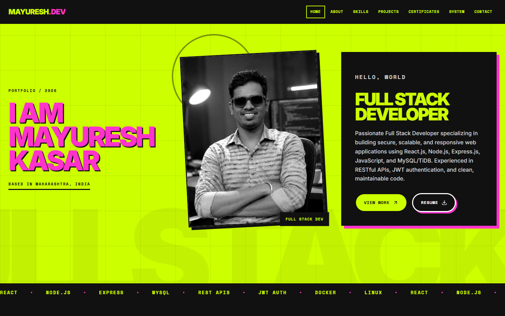
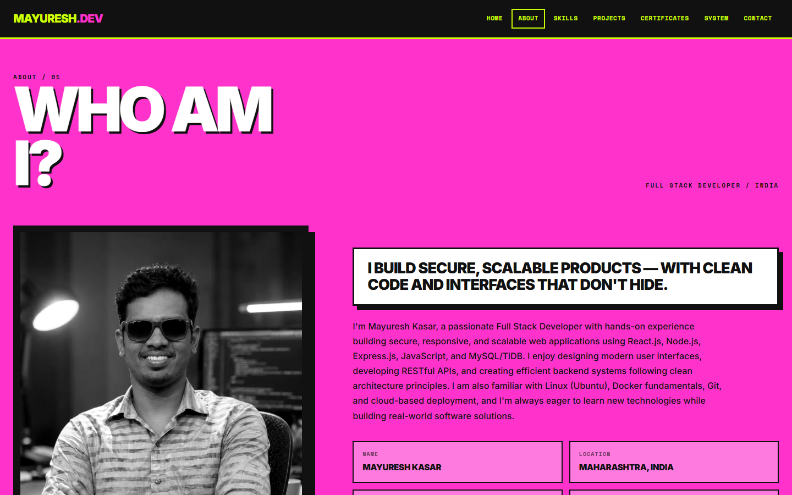
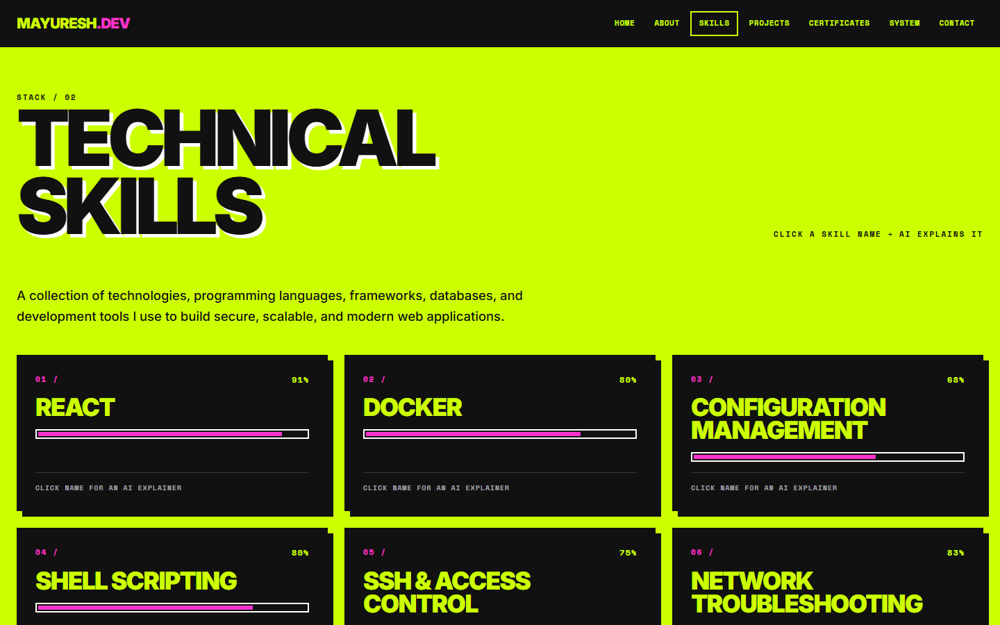
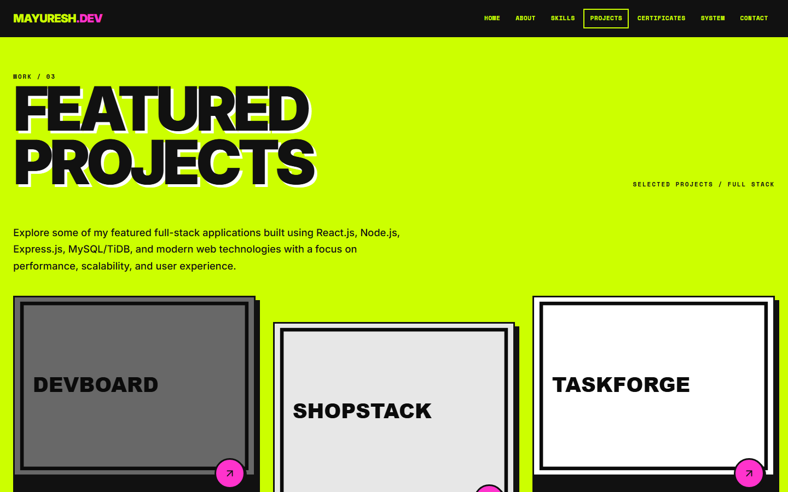
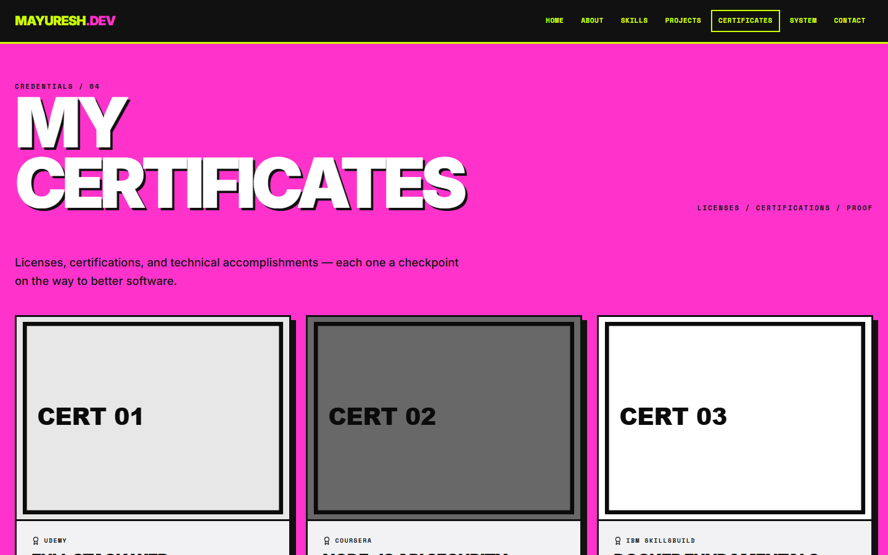
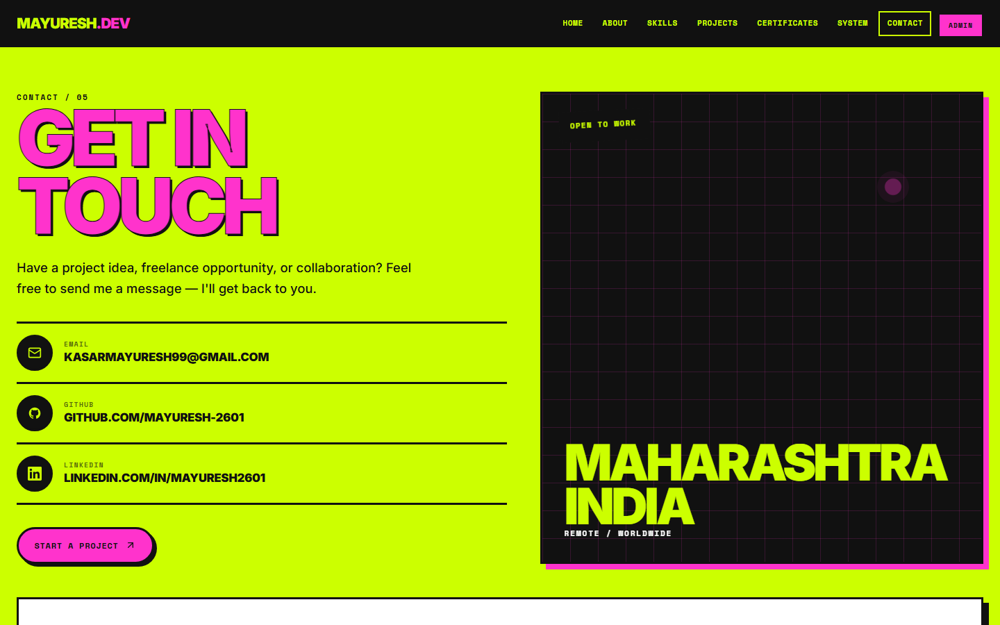
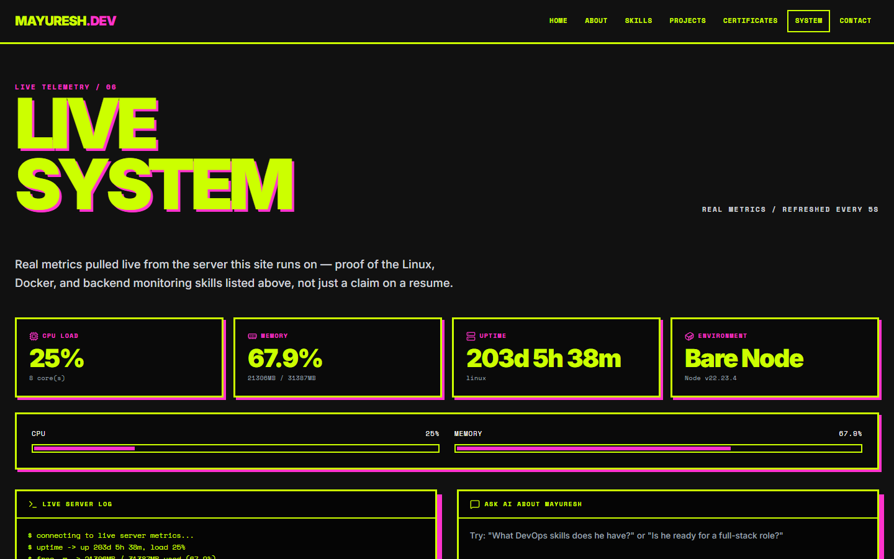
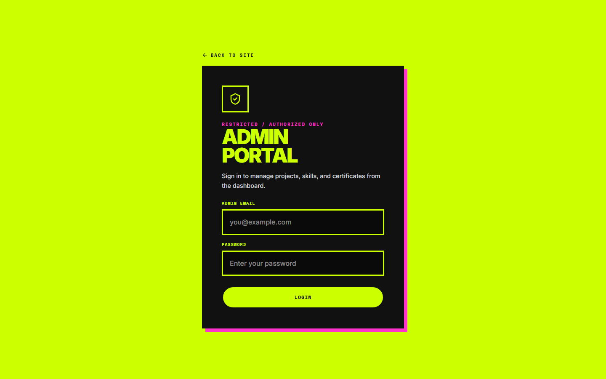
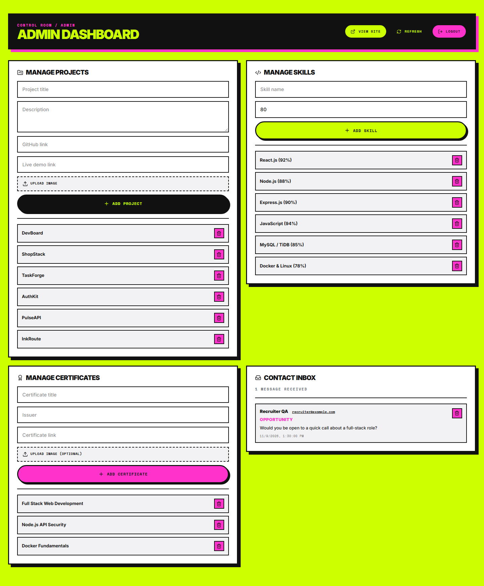

<div align="center">

# Mayuresh Kasar — Portfolio App

**A production-grade full-stack portfolio with AI-powered explanations and a live DevOps monitoring panel.**

[](https://mk-portfolio-phi-silk.vercel.app/)
[](https://mk-portfolio-api.onrender.com)
[](#license)
[](https://nodejs.org)

[Live Demo](https://mk-portfolio-phi-silk.vercel.app/) · [Report a Bug](https://github.com/mayuresh-2601/MK-PORTFOLIO/issues) · [Request a Feature](https://github.com/mayuresh-2601/MK-PORTFOLIO/issues)

</div>

---

## Table of Contents

- [Overview](#overview)
- [Screenshots](#screenshots)
- [Features](#features)
- [Tech Stack](#tech-stack)
- [Architecture](#architecture)
- [Quick Start](#quick-start)
- [Environment Variables](#environment-variables)
- [Database Schema](#database-schema)
- [API Reference](#api-reference)
- [Docker](#docker)
- [Deployment](#deployment)
- [Troubleshooting](#troubleshooting)
- [Roadmap](#roadmap)
- [Contributing](#contributing)
- [Author & License](#author--license)

---

## Overview

This repository is a full-stack developer portfolio — not a static template, but a real application with its own backend, database, authentication, and admin dashboard. It's built to demonstrate the same engineering practices used in production software:

- **`client/`** — React 18 + Vite public site and admin UI
- **`server/`** — Node.js + Express REST API with JWT auth, file uploads, and email
- **AI layer** — Google Gemini-powered explanations and a live Q&A assistant, so visitors don't just read a skill list, they can ask about it
- **DevOps proof, not claims** — a `/system` page shows real, live server metrics (CPU, memory, uptime, environment) pulled from the actual deployed backend, not hardcoded numbers

---

## Screenshots

### Public Site

| Home | About |
|---|---|
|  |  |

| Skills — AI Explain | Projects |
|---|---|
|  |  |

| Certificates | Contact |
|---|---|
|  |  |

### DevOps Proof — Live System Panel



Real, live CPU load, memory usage, uptime, and environment info pulled straight from the
running backend — not mocked data. Refreshes every 5 seconds. See [Live System
panel](#features) above for details.

### Admin Dashboard

| Login | Dashboard |
|---|---|
|  |  |

JWT-authenticated admin area for managing projects, skills, and certificates — full CRUD,
no direct database access needed.

---

## Features

### Public site
- Responsive, accessible **Kinetic Brutalism** UI — acid/ink/pink palette, hard borders, offset shadows, marquee, count-up stats, scroll reveals, and reduced-motion support
- Self-hosted Inter and Space Mono fonts (no external font requests), keyboard-trapped dialogs, and a skip-to-content link
- Projects, Skills, Certificates, About, and Contact pages backed by the database — not hardcoded
- Contact form that stores messages (including the subject) and sends email notifications; a failed email never loses the saved message

### AI-powered explanations *(new)*
- Click any skill or certificate to get a short, plain-language explanation generated on demand by **Google Gemini** (`gemini-3.5-flash-lite`)
- **Ask AI About Me** chat on the `/system` page — visitors can ask questions like *"what DevOps skills does he have?"* and get an answer grounded in real listed skills, not hallucinated claims
- Per-IP rate limiting on all AI endpoints to prevent abuse of the paid API

### Live System panel *(new)*
- Real-time CPU load, memory usage, uptime, and Docker/bare-Node environment detection — read live from the actual running server via Node's `os`, `fs`, and `child_process` modules
- Terminal-style live log panel that appends real metric lines every 5 seconds
- This page exists specifically to prove Linux/DevOps skills with live evidence instead of a resume bullet point

### Admin dashboard
- JWT-authenticated admin login
- Create and delete projects, skills, and certificates (project update API included)
- Contact inbox: read and delete messages submitted through the public form
- Optional certificate artwork + required project images
- Cloudinary-backed image uploads (the API stays online if Cloudinary is not configured; uploads return a clear `503`)

### Security model
- **One admin identity** — only the exact `ADMIN_EMAIL` plus `ADMIN_PASSWORD`
  (or bcrypt `ADMIN_PASSWORD_HASH`) from `server/.env` can access `/admin`
- **Constant-time credential checks** — the plain-text path hashes both values
  with SHA-256 and uses `crypto.timingSafeEqual`; the bcrypt path uses
  `bcrypt.compare`
- **Hardened sessions** — HS256 JWT with issuer/audience checks, a 12-hour
  default expiry, and a role/email claim tied to the current admin
- **Login rate limiting** — 10 failed attempts per 15 minutes per IP
- **No secret in the client** — passwords, hashes, refresh tokens, and API keys
  stay in server-side environment variables; `.env` is gitignored and excluded
  from the shareable ZIP
- **Gmail over HTTPS** — the Gmail API path avoids blocked SMTP ports on Render
  free and validates the OAuth refresh token before sending

---

## Tech Stack

| Layer | Technology |
|---|---|
| Frontend | React 18, React Router 7, Vite 6, Tailwind CSS v4, custom Kinetic Brutalism CSS, Lucide Icons, Fontsource |
| Backend | Node.js, Express 5 (ES Modules) |
| Database | MySQL-compatible — TiDB Cloud |
| Auth | JWT + timing-safe env credentials (bcrypt optional) |
| File Storage | Cloudinary |
| Email | Nodemailer |
| AI | Google Gemini API (`gemini-3.5-flash-lite`) |
| Deployment | Vercel (frontend) · Render (backend) |
| Containerization | Docker + Docker Compose |

---

## Architecture

```
                        ┌─────────────────────┐
                        │      Visitor         │
                        └──────────┬───────────┘
                                   │ HTTPS
                        ┌──────────▼───────────┐
                        │   Vercel (Client)     │
                        │   React + Vite SPA    │
                        └──────────┬───────────┘
                                   │ REST API (axios)
                        ┌──────────▼───────────┐
                        │   Render (Backend)    │
                        │   Node.js + Express   │
                        ├───────────────────────┤
                        │ /api/projects         │
                        │ /api/skills           │
                        │ /api/certificates     │
                        │ /api/messages         │
                        │ /api/auth             │
                        │ /api/ai/*    (Gemini) │──────► Google Gemini API
                        │ /api/system  (live)   │──────► os / fs / child_process
                        └──────────┬───────────┘
                                   │ mysql2
                        ┌──────────▼───────────┐
                        │   TiDB Cloud (DB)     │
                        └───────────────────────┘
```

---

## Quick Start

### Prerequisites
- Node.js **≥ 22.0** (current LTS)
- npm
- A TiDB Cloud (or MySQL-compatible) database
- Optional: [Google Gemini API key](https://aistudio.google.com/app/apikey), Cloudinary account, Gmail account (App Password or OAuth client for the Gmail API)

### 1. Clone

```bash
git clone https://github.com/mayuresh-2601/MK-PORTFOLIO.git
cd MK-PORTFOLIO
```

### 2. Backend

```bash
cd server
npm install
cp .env.example .env      # then fill in your real values
node -e "console.log(require('crypto').randomBytes(48).toString('hex'))"
npm run db:setup          # fresh database: create tables
npm run db:seed           # import the portfolio content
npm run db:check          # verify schema and row counts
npm run dev
```

In `server/.env`, set `ADMIN_EMAIL` and **one** of:

- `ADMIN_PASSWORD` — a plain-text password of at least 12 characters. This is
  the simplest option and is compared in constant time.
- `ADMIN_PASSWORD_HASH` — an optional bcrypt hash. If both are set, the hash
  wins.

Only that exact email and password can log in to `/admin`. Paste the generated
random string into `JWT_SECRET`.

For a database created by an older version, use `npm run db:migrate` instead of
`db:setup`. The migration is idempotent and adds `messages.subject`, makes
certificate images optional, converts tables to `utf8mb4`, and removes the
unused `users` table.

Runs on **http://localhost:5000**. You should see:
```
✅ Database connected successfully.
🚀 API listening on 0.0.0.0:5000 (development).
```

Verify it with `curl http://localhost:5000/api/health/ready`.

> 🔑 Secrets are never committed. Recreate `server/.env` from
> [`server/.env.example`](server/.env.example); see
> [`PENDRIVE-README.md`](PENDRIVE-README.md) for the full first-run checklist.
> [`docs/RESTORE_NOTES.md`](docs/RESTORE_NOTES.md) records the original
> restore and the secrets that must be re-entered.

### 3. Frontend

Open a **new terminal**:

```bash
cd client
npm install
npm run dev
```

No client-side env file is needed. The Vite dev server proxies `/api` to
`http://localhost:5000` (override with `VITE_PROXY_TARGET`), and production
builds use same-origin `/api`. For a split deployment such as Vercel frontend +
Render backend, set `VITE_API_BASE_URL` in the hosting provider's environment
settings (see [Deployment](#deployment)).

Runs on **http://localhost:5173**.

---

## Environment Variables

### `server/.env`

```env
PORT=5000
HOST=0.0.0.0

# Comma-separated allowed browser origins (no trailing slash).
CLIENT_URL=http://localhost:5173
# Set true only if every *.vercel.app preview should be allowed.
ALLOW_VERCEL_PREVIEWS=false

DB_HOST=your-tidb-host
DB_PORT=4000
DB_USER=your-db-user
DB_PASSWORD=your-db-password
DB_NAME=portfolio

# true for TiDB Cloud; false for a local MySQL container.
DB_SSL=true

# Optional connection pool size (default 10, capped at 20)
DB_CONNECTION_LIMIT=10

JWT_SECRET=replace-with-a-long-random-string
JWT_EXPIRES_IN=12h

# Exactly one admin identity. Set ADMIN_PASSWORD (plain, 12+ chars) ...
ADMIN_EMAIL=your-real-admin@gmail.com
ADMIN_PASSWORD='your-long-unique-password'

# ... or use a bcrypt hash instead (optional; wins if both are set).
# Single quotes keep Docker Compose from interpolating the `$` characters.
# Render's dashboard takes the raw hash without quotes.
# ADMIN_PASSWORD_HASH='$2b$12$...'

# Optional — uploads return 503 until these are set.
CLOUD_NAME=your-cloudinary-cloud-name
CLOUD_API_KEY=your-cloudinary-api-key
CLOUD_API_SECRET=your-cloudinary-api-secret

# Optional — messages are saved even if email delivery fails.
# Gmail API over HTTPS (needed on Render's free tier; SMTP is blocked):
EMAIL_USER=your-real-email@gmail.com
GMAIL_CLIENT_ID=
GMAIL_CLIENT_SECRET=
GMAIL_REFRESH_TOKEN=
EMAIL_TRANSPORT=auto

# Or Gmail SMTP with an App Password (local / paid hosting):
# EMAIL_PASS=your-16-character-app-password

# Optional — powers "Explain with AI" and "Ask about me".
# Get a free key at https://aistudio.google.com/app/apikey
GEMINI_API_KEY=your-gemini-api-key-here
```

`ADMIN_PASSWORD` is the simple plain-text option. `ADMIN_PASSWORD_HASH` is
optional and takes precedence when both are set; generate it with
`npm run hash-password -- "your-password"`. Multiple production origins can be
comma-separated in `CLIENT_URL`. `DB_PASSWORD` must be defined even when it is
empty (local MySQL root).

### Gmail delivery

Gmail SMTP is blocked on Render's **free** web services (ports 25, 465, and
587). Use one of these:

- **Gmail API (recommended, free tier)** — enable the Gmail API in Google Cloud,
  create a Desktop OAuth client, put `GMAIL_CLIENT_ID` and
  `GMAIL_CLIENT_SECRET` in `server/.env`, then run `npm run gmail:auth`. The
  script writes `GMAIL_REFRESH_TOKEN` and sets `EMAIL_TRANSPORT=gmail-api`.
  Restart the API, then verify with `npm run email:check` and send a test with
  `npm run email:test`.
- **Gmail SMTP** — create a Google App Password, set `EMAIL_USER` and
  `EMAIL_PASS`, and use `EMAIL_TRANSPORT=smtp`. Works locally and on a paid
  Render instance.

Contact messages are saved even when email fails, so the public form never
loses a submission.

### `client/.env` *(optional)*

No env file is required for local development, `vite preview`, or Docker:
requests go to same-origin `/api`, which Vite and Nginx proxy to the backend.
Only set a value for a split deployment or a non-default proxy target.

```env
# Optional — only for split deployments (Vercel frontend + remote backend).
# Set this in the hosting provider's environment settings, not in Git.
VITE_API_BASE_URL=https://your-backend.onrender.com

# Optional — change the local Vite /api proxy target (default :5000).
# VITE_PROXY_TARGET=http://localhost:5000
```

`client/.env.example` documents both options.

### Docker Compose root `.env`

```env
# Local MySQL container only — copy .env.example to .env
DB_PASSWORD=portfolio_local_dev_password
DB_NAME=portfolio
```

**Never commit real secrets.** Both `.env` files are already listed in `.gitignore` — only `.env.example` (with placeholders) should ever be committed.

---

## Database Schema

The authoritative schema is [`server/database/schema.sql`](server/database/schema.sql).
Fresh installs should use the tooling instead of pasting SQL:

```bash
npm run db:setup    # create database + tables
npm run db:seed     # 4 projects, 16 skills, 16 certificates
npm run db:check    # verify tables, columns, charset, row counts
```

For an existing database, `npm run db:migrate` applies the same changes
idempotently. The migration SQL is documented in
[`server/database/migrations/001_production_hardening.sql`](server/database/migrations/001_production_hardening.sql).

| Table | Purpose | Notable columns |
|---|---|---|
| `projects` | Portfolio case studies | `title`, `description`, `github`, `demo`, `image` |
| `skills` | Skill bars | `name`, `level` (0–100) |
| `certificates` | Credentials | `title`, `issuer`, nullable `image`, `link` |
| `messages` | Contact inbox | `name`, `email`, `subject`, `message` |

All tables use InnoDB + `utf8mb4_unicode_ci`. Admin authentication is
environment-based (`ADMIN_EMAIL` + `ADMIN_PASSWORD` or `ADMIN_PASSWORD_HASH`),
so there is no unused `users` table or stale password hash in the database.
Only the email/password pair configured in `server/.env` can access `/admin`.

---

## API Reference

Base URL (development): `http://localhost:5000/api`

### Auth

**`POST /api/auth/login`**
```json
{ "email": "admin@example.com", "password": "your_password" }
```
→ `{ "success": true, "token": "<JWT>" }`

### Projects / Skills / Certificates

**`GET /api/projects`** · **`GET /api/skills`** · **`GET /api/certificates`** — public, return `{ success, count, data: [...] }`

**`POST /api/projects`** *(protected — `Authorization: Bearer <JWT>`, multipart/form-data)*
Fields: `title`, `description`, `github`, `demo`, `image`

**`POST /api/skills`** *(protected — JSON)*
Fields: `name`, `level`

**`POST /api/certificates`** *(protected — multipart/form-data)*
Fields: `title`, `issuer`, `link`, optional `image`

**`PUT /api/projects/:id`** *(protected — multipart/form-data)*
Fields: `title`, `description`, `github`, `demo`, optional `image` (keeps the current image when omitted)

**`PUT /api/skills/:id`** *(protected — JSON)*
Fields: `name`, `level`

**`PUT /api/certificates/:id`** *(protected — multipart/form-data)*
Fields: `title`, `issuer`, `link`, optional `image` (keeps the current image when omitted)

**`DELETE /api/projects/:id`** · **`DELETE /api/skills/:id`** · **`DELETE /api/certificates/:id`** — protected. Removes one record.

### Contact

**`POST /api/messages`** — public. Fields: `name`, `email`, `subject`, `message`, optional `file`
(image, PDF, DOC, DOCX; 10 MB max). Returns `201` after the message is saved.
Email delivery is best-effort and never turns a saved message into an error.
Rate limited to 5 submissions per 15 minutes per IP.

**`GET /api/messages`** — protected. Returns `{ success, count, data }`.
**`DELETE /api/messages/:id`** — protected. Deletes one message.

### AI *(new)*

**`POST /api/ai/explain-skill`**
```json
{ "name": "Docker", "level": 75 }
```
→ `{ "success": true, "explanation": "..." }`

**`POST /api/ai/explain-certificate`**
```json
{ "title": "AWS Certified Developer", "issuer": "Amazon" }
```

**`POST /api/ai/ask-about-me`**
```json
{ "question": "What DevOps skills does he have?" }
```
→ `{ "success": true, "answer": "..." }`

Rate limited to ~10 requests/minute per IP. Returns `429` if exceeded, `502` if `GEMINI_API_KEY` is missing or the Gemini API errors.

### System *(new)*

**`GET /api/system`** — public, rate limited to 120 requests/minute per IP (separate from the shared API budget, since the `/system` page polls it every 5 seconds)
```json
{
  "success": true,
  "data": {
    "host": { "hostname": "...", "platform": "linux", "uptimeSeconds": 1234 },
    "cpu": { "cores": 2, "loadPercent": 14.2 },
    "memory": { "usedMB": 320, "totalMB": 2048, "usedPercent": 15.6 },
    "docker": { "runningInContainer": false },
    "git": { "commit": "a1b2c3d", "branch": "main" }
  }
}
```

Full route definitions: `server/routes/` · Full controller logic: `server/controllers/`

---

## Docker

Local containerized development:

```bash
cp .env.example .env                        # root: local MySQL password + DB name
cp server/.env.example server/.env          # API: auth + optional integrations
```

Edit `server/.env` and replace the placeholder `JWT_SECRET` (32+ random
characters), `ADMIN_EMAIL`, and `ADMIN_PASSWORD` (12+ characters). The API
validates its environment at startup, so placeholders stop the container
even for a local read-only site. Cloudinary, Gmail, and Gemini values can
stay blank; those features degrade gracefully.

```bash
docker compose up --build
```

`docker-compose.yml` overrides the server's `DB_HOST`, `DB_PORT`, `DB_USER`,
`DB_PASSWORD`, and `DB_SSL` so the API talks to the `db` container
automatically — even if `server/.env` points at TiDB Cloud for normal local
development.

Open **http://localhost** when all three containers are healthy. A fresh
database is initialized with `schema.sql` and seeded with the baseline
portfolio content.

---

## Deployment

Full instructions, environment tables, smoke tests, and rollback steps are in
[`DEPLOYMENT.md`](DEPLOYMENT.md). This repository ships a
[`render.yaml`](render.yaml) Blueprint for the API.

### Frontend → Vercel
1. Import the repo, set the project root to `client/`
2. Build command: `npm run build` · Output directory: `dist`
3. Add `VITE_API_BASE_URL` = your Render backend URL (no trailing slash)
4. Redeploy after changing it — Vite bakes env values into the build
5. `client/vercel.json` adds SPA rewrites, security headers, and immutable
   caching for hashed assets

### Backend → Render
1. New → Blueprint, select the repo (or create a Web Service with root `server/`)
2. Build command: `npm ci` · Start command: `npm start`
3. Health check path: `/api/health`
4. Set the TiDB values, `JWT_SECRET`, `ADMIN_EMAIL`, and either
   `ADMIN_PASSWORD` or `ADMIN_PASSWORD_HASH`, plus `CLIENT_URL` (production
   Vercel origin, no trailing slash)
5. For email on the free tier, set `EMAIL_USER`, `GMAIL_CLIENT_ID`,
   `GMAIL_CLIENT_SECRET`, `GMAIL_REFRESH_TOKEN`, and `EMAIL_TRANSPORT=gmail-api`
   (SMTP ports are blocked on free instances). Optional `CLOUD_*` and
   `GEMINI_API_KEY` can stay empty; the API boots and the public site remains
   fully usable

### Database → TiDB Cloud
1. Create a Starter cluster and a `portfolio` database
2. Copy host/user/password, keep `DB_PORT=4000`, `DB_SSL=true`
3. From `server/`, run `npm run db:setup`, `npm run db:seed`, `npm run db:check`
4. Allow Render's egress (or `0.0.0.0/0` on Starter)

After deploying, visit `/system` on your live site — if it shows real, changing numbers, both the deployment and the DevOps monitoring feature are working correctly. The admin dashboard also includes a contact inbox for messages stored in TiDB.

---

## Troubleshooting

| Symptom | Likely cause | Fix |
|---|---|---|
| `'vite' is not recognized` | `npm install` wasn't run (or didn't finish) in that folder | Run `npm install` in `client/` and `server/` separately, wait for it to finish, then `npm run dev` |
| `Missing environment variables` on Render | An env var is absent or empty | `DB_PASSWORD` must be defined even if empty; check Render → Environment |
| Render cold start feels slow | Free web services sleep after idle | The client waits 60 s and retries a failed GET once; upgrade the Render plan for always-on |
| `/system` says "Live metrics unavailable" | The API is not reachable at the proxied origin | Start the backend on port 5000 (or set `VITE_PROXY_TARGET` for local dev). For a split deployment, set `VITE_API_BASE_URL` to the public backend origin and redeploy |
| AI explain modal shows an error | `GEMINI_API_KEY` missing/invalid on the backend | Add a real key from [Google AI Studio](https://aistudio.google.com/app/apikey) to `server/.env` (local) or Render's environment variables (production) |
| Admin login always fails | `ADMIN_PASSWORD`/`ADMIN_PASSWORD_HASH` is still a placeholder, or does not match the password you are typing | Set `ADMIN_PASSWORD` to the exact 12+ character password, or regenerate `ADMIN_PASSWORD_HASH` from `server/`, restart the API, and log in with `ADMIN_EMAIL` |
| CORS errors in browser console | `CLIENT_URL` in `server/.env` doesn't match the frontend's actual origin | Set it to exactly `http://localhost:5173` (dev) or your Vercel URL (prod) — no trailing slash mismatch |
| DB connection errors | Wrong host/port/credentials, or TiDB Cloud IP allowlist blocking Render | Double-check `server/.env` DB values; in TiDB Cloud, allow connections from `0.0.0.0/0` or Render's IP range |
| Image upload failures | Bad Cloudinary credentials | Verify `CLOUD_NAME`, `CLOUD_API_KEY`, `CLOUD_API_SECRET` |
| Email not sending | Wrong Gmail credentials, or Render free blocking SMTP | Run `npm run email:check` / `npm run email:test`; on Render free use Gmail API (`GMAIL_*` + `EMAIL_TRANSPORT=gmail-api`) instead of an App Password |

Check the server terminal (`npm run dev` in `server/`) for full stack traces on any backend error.

---

## Roadmap

- [ ] WebSocket-based live push for `/system` instead of polling
- [x] CI/CD pipeline via GitHub Actions (build + test on every push)
- [ ] Deploy a second instance to a raw Linux VM (EC2/Oracle Cloud) behind Nginx, as a DevOps deep-dive companion project
- [ ] Dark/light theme toggle

---

## Contributing

1. Fork the repository
2. Create a branch: `git checkout -b feature/your-feature`
3. Commit your changes with a clear message
4. Open a pull request

---

## Author & License

**Mayuresh Kasar** — Full-Stack Developer
[LinkedIn](https://linkedin.com/in/mayuresh2601) · [GitHub](https://github.com/mayuresh-2601) · [Live Site](https://mk-portfolio-phi-silk.vercel.app/)

Licensed under the [MIT License](LICENSE).
