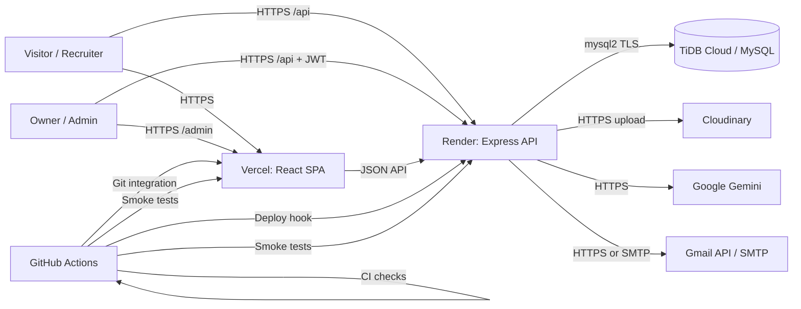
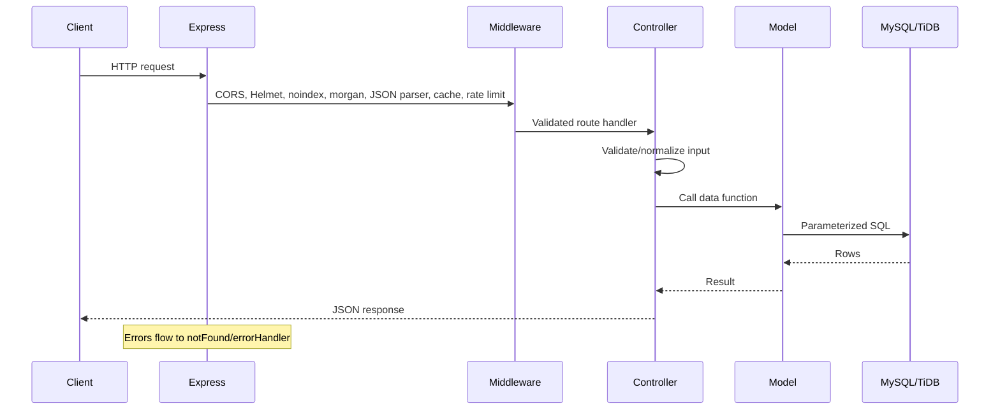
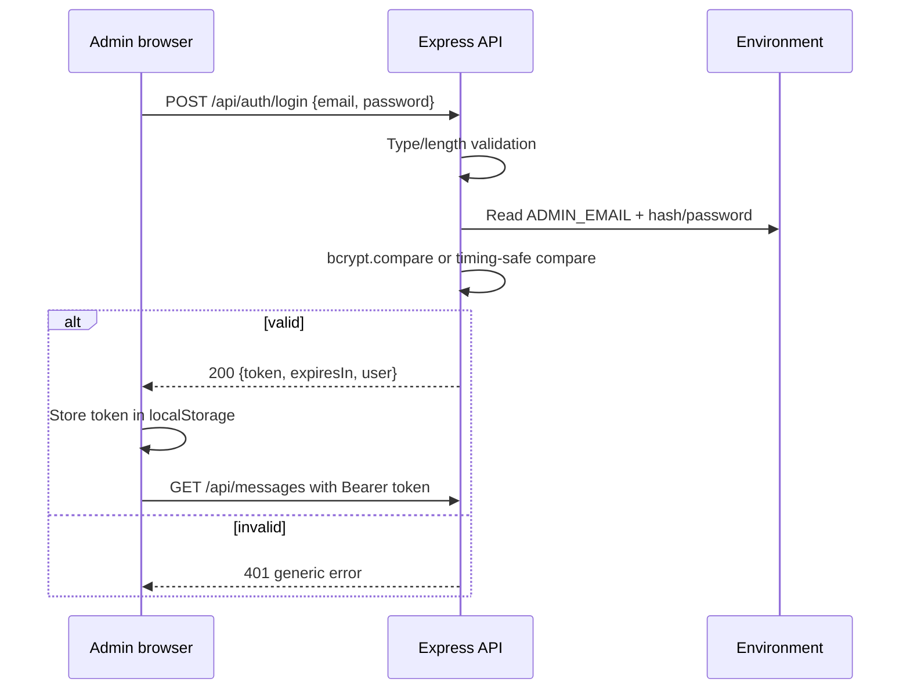

# System Architecture

**Product:** Mayuresh Kasar Portfolio ("MAYURESH.DEV")
**Document owner:** Mayuresh Kasar
**Status:** Source of truth for technical architecture
**Version:** 1.0
**Last updated:** 2026-11-14
**Inputs:** [PRD.md](./PRD.md) · [DESIGN.md](./DESIGN.md)
**Related:** [DATABASE.md](./DATABASE.md) · [API.md](./API.md) · [AGENTS.md](./AGENTS.md)

---

## 1. Architecture summary

The product is a **split-deployment modular monolith**:

- A **React single-page application** built with Vite and served as static files by Vercel (or Nginx in Docker).
- A **Node.js/Express REST API** deployed on Render (or in Docker locally).
- A **MySQL-compatible database** hosted on TiDB Cloud in production and MySQL 8 locally.
- Optional **Cloudinary** media hosting, **Google Gemini** AI, and **Gmail API/SMTP** notifications.
- **GitHub Actions** as the CI/CD control plane, triggering Render deployments only after all checks pass.

There are no microservices, queues, caches, or background workers. The data volume and traffic profile do not justify them. This keeps the system deployable by one owner and understandable by one coding agent.

### Context diagram



### Key decisions

| Decision | Choice | Reason |
|---|---|---|
| Frontend | React 18 + Vite 6 + React Router 7 | Small SPA, fast builds, familiar ecosystem, no SSR requirement |
| Styling | Tailwind 4 import + bespoke CSS design system | Tailwind reset/utilities available; the visual identity lives in explicit CSS tokens |
| Backend | Express 5 on Node.js 22 | Minimal, well-understood HTTP layer; native async error handling |
| Database | MySQL 8/TiDB Cloud with `mysql2` | Relational content, SQL clarity, managed TLS, low cost |
| ORM | None | Four tables, simple queries; parameterized SQL is clearer and smaller |
| Auth | Single admin, env credentials, JWT HS256 | No user accounts; minimal attack surface |
| Media | Cloudinary | No persistent disk on Render; managed transforms and delivery |
| AI | Direct Gemini REST call | No SDK dependency; timeout and response parsing stay explicit |
| Email | Gmail API preferred, SMTP fallback | Render free tier blocks SMTP; API works over HTTPS |
| Frontend host | Vercel | Git integration, CDN, headers, SPA rewrites |
| API host | Render | Simple Node hosting, health checks, API-triggered deploys |
| CI/CD | GitHub Actions | Already the source of truth; no extra CI service |

## 2. Technology stack

### Frontend

| Package | Version | Purpose |
|---|---|---|
| React / React DOM | 18.3 | UI runtime |
| React Router DOM | 7.18 | Client-side routing |
| Vite | 6 | Dev server and production build |
| Tailwind CSS | 4 | Utility/reset layer via `@tailwindcss/vite` |
| Axios | 1.15 | HTTP client, interceptors, timeout, one GET retry |
| Lucide React | 1.11 | Icon set |
| `@fontsource/inter` | 5.3 | Self-hosted Inter |
| `@fontsource/space-mono` | 5.3 | Self-hosted Space Mono |
| ESLint | 9.15 | Static checks |

No global state library. Page-local `useState`/`useEffect` is sufficient. Shared behavior lives in small components/hooks (`SEO`, `AIExplainModal`, `useScrollReveal`, `safeExternalUrl`).

### Backend

| Package | Version | Purpose |
|---|---|---|
| Express | 5.2 | HTTP routing and middleware |
| `mysql2` | 3.22 | Connection pool and prepared statements |
| `jsonwebtoken` | 9.0 | Admin JWT |
| `bcryptjs` | 3.0 | Password hash verification |
| `helmet` | 8.1 | Security headers |
| `cors` | 2.8 | Origin allowlist |
| `express-rate-limit` | 8.7 | Abuse controls |
| `multer` | 2.1 | In-memory multipart parsing |
| `cloudinary` | 2.11 | Media upload |
| `nodemailer` | 10.4 | Gmail API MIME and SMTP |
| `morgan` | 1.10 | Access logs |
| `dotenv` | 17.4 | Local environment loading |

No ORM, no validation library, no queue, no Redis, no WebSocket server.

### Platform

| Layer | Production | Local |
|---|---|---|
| Frontend | Vercel static build | Vite dev server / preview / Nginx |
| API | Render Web Service, Node 22 | Node 22 / Docker |
| Database | TiDB Cloud Serverless (MySQL compatible) | MySQL 8 container or local MySQL |
| Media | Cloudinary | Cloudinary or uploads disabled |
| AI | Gemini `gemini-3.5-flash-lite` | Same, optional |
| Email | Gmail API (preferred) | Gmail API or SMTP, optional |
| CI/CD | GitHub Actions | npm scripts / Docker Compose |

## 3. Frontend architecture

### Runtime structure

```text
client/
├── index.html                 SPA shell, static SEO, JSON-LD, noscript
├── vercel.json                Headers, admin noindex, SPA rewrite
├── nginx.conf                 Docker headers, gzip, SPA fallback, /api proxy
├── public/                    Portrait, resume, OG image, robots, sitemap, IndexNow key
└── src/
    ├── main.jsx               React root + router
    ├── App.jsx                Routes, skip link, nav/footer visibility, scroll reset
    ├── index.css              Tokens, layout, components, responsive, reduced motion
    ├── api/axios.js           Base URL, JWT header, 401 handling, cold-start retry
    ├── components/
    │   ├── common/            Navbar, Footer, SEO, AIExplainModal, CountUp, Marquee, StatsBand
    │   └── protected/         ProtectedRoute
    ├── hooks/                 useScrollReveal
    ├── pages/public/          Home, About, Skills, Projects, Certificates, System, Contact
    ├── pages/admin/           AdminLogin, AdminDashboard
    ├── utils/safeUrl.js       HTTP(S)-only external link guard
    └── assets/                GitHub/LinkedIn icons
```

### Rendering and routing

- `BrowserRouter` wraps the app in `main.jsx`; `App.jsx` declares all routes.
- Vercel/Nginx rewrite unknown paths to `index.html`; React Router renders the 404 route for unknown client paths. This is why production returns HTTP 200 for unknown SPA routes; the 404 is a client-rendered state and sends `noindex`.
- Public routes render the fixed `Navbar` and `Footer`; `/admin*` routes do not.
- Each route mounts a page that owns its data fetching and local UI state.
- Route changes scroll to top instantly and replay a short entrance animation.
- `SEO` mutates `document.title`, description, robots, canonical, Open Graph, and Twitter tags per route.

### Data fetching

- `client/src/api/axios.js` creates one Axios instance.
- `baseURL` is `${VITE_API_BASE_URL}/api`; when the variable is empty, requests are same-origin and rely on the Vite/Nginx proxy.
- Access tokens are read from `localStorage` and attached as `Authorization: Bearer <token>`.
- Multipart requests let the browser set `Content-Type`.
- One automatic retry is allowed for idempotent `GET` requests when there is no response (cold start/network failure), after a 2-second delay.
- A `401` clears local auth. Admin pages redirect to `/admin`; the login request is excluded so the form error is preserved.
- Public pages support both bare arrays and `{ success, data }` envelopes for resilience, although the API consistently returns envelopes.

### UI state model

| State | Owner | Pattern |
|---|---|---|
| Projects/skills/certificates lists | Page component | `loading`, `error`, data array |
| Contact submission | Contact page | `{ loading, success, error }` |
| AI explanation | Reusable modal | `loading`, `error`, `explanation`, cancellation flag |
| System snapshot | System page | Snapshot + inline error, 5-second poll |
| Admin data | Dashboard | Four arrays + global `loading` + feedback banner |
| Auth | `localStorage` + route guard | Token presence gate; server remains authoritative |

### Build and environment

- Vite exposes only `VITE_*` variables to the browser.
- `VITE_API_BASE_URL` is baked into the build and must be set in Vercel for the split deployment.
- `VITE_PROXY_TARGET` is local-only and points Vite dev/preview at the API.
- No server secret is imported into client code.
- The build must produce `dist/index.html`, `dist/assets`, the React root, and per-page SEO markers checked by CI.

## 4. Backend architecture

### Layering

```text
server/
├── server.js                 App bootstrap, middleware, routes, health, shutdown
├── config/                   Database, Cloudinary, email, environment validation
├── routes/                   URL + method + middleware wiring
├── middleware/               Auth, rate limits, upload, errors/404
├── controllers/              Request validation, status codes, orchestration
├── models/                   Parameterized SQL, explicit columns
├── services/                 Gemini API wrapper
├── utils/                    Validation, admin auth, email, client IP
├── database/                 schema.sql, seed.sql, database Dockerfile
├── scripts/                  db setup/migrate/seed/check, hash, Gmail, email test
└── tests/                    node:test unit tests
```

Request flow:



### Bootstrap order

1. Load `.env` with `dotenv/config`.
2. Validate environment (`validateEnvironment`); fatal errors stop the process, optional-integration warnings do not.
3. Read admin and email config.
4. Disable `x-powered-by`; set `trust proxy` to 1; enable JSON HTML escaping.
5. Configure CORS with an exact origin allowlist.
6. Apply Helmet, API noindex, morgan, body parsers, and `/api` no-store.
7. Register health routes outside the rate limiter.
8. Apply the shared API limiter and mount feature routes.
9. Register 404 and error middleware.
10. Verify the database with `SELECT 1`; start listening only after success.
11. Set keep-alive and headers timeouts above Render's 60-second proxy timeout.
12. Register graceful shutdown and fatal-error handlers.

### Middleware order (security-relevant)

`CORS → Helmet → X-Robots-Tag → morgan → JSON/urlencoded parsers → no-store → health → rate limiter → routes → 404 → error handler`

Notes:

- CORS rejects a disallowed browser origin by omitting headers, not by throwing a 500.
- Health endpoints are deliberately not rate-limited so Render and CI can probe them.
- The shared limiter skips `/health`, `/health/ready`, and `/system`; `/system` has its own limiter.
- `express.urlencoded` uses `extended: false`.
- JSON and URL-encoded bodies are limited to 1 MB; uploads are handled by Multer with separate limits.

### Validation and errors

- Controllers validate types, required fields, lengths, numeric ranges, and URL protocols before calling models.
- Models use `db.execute` with placeholders; no string interpolation of user input.
- Public list queries select explicit columns, never `SELECT *`.
- 404 responses do not echo the attacker-controlled path.
- Body-parser errors are normalized to stable messages (`Malformed JSON request body.`, `Request body is too large.`).
- Production 5xx responses return `Internal Server Error`; stack traces are development-only.
- Fatal rejection/exception logs serialize only stacks/messages/primitives, never arbitrary objects that could contain headers or tokens.

## 5. Database interaction

- One `mysql2/promise` pool is created at startup from shared config.
- Pool defaults: connection limit 10 (capped 1–20), wait queue enabled, idle timeout 60 s, keep-alive enabled, named placeholders enabled.
- TLS defaults to enabled in production; local MySQL/Docker sets `DB_SSL=false`. TLS 1.2+ with certificate verification for TiDB.
- `charset: utf8mb4`, 20-second connect timeout.
- Models expose small functions (`getAllProjects`, `getProjectById`, `addProject`, `updateProject`, `deleteProject`, and equivalents for skills, certificates, messages).
- Each mutation is a single SQL statement. No multi-step transaction is required at current scope.
- Updates use partial-field logic in controllers: omitted fields keep existing values; explicit empty optional fields clear links; `COALESCE` preserves an existing image when no replacement is uploaded.
- Readiness is proven by `SELECT 1`; there is no separate migration service at runtime.

Detailed schema and query mapping: [DATABASE.md](./DATABASE.md).

## 6. Authentication and authorization

### Model

- Exactly one admin identity, configured through environment variables.
- Production uses `ADMIN_PASSWORD_HASH` (bcrypt); `ADMIN_PASSWORD` remains supported for local development and is compared in constant time.
- If both are present, the bcrypt hash wins.
- No `users` table, signup, password reset, or roles beyond `admin`.

### Login flow



### Token

- HS256 only.
- Claims: `sub` = admin email, `email` = admin email, `role` = `admin`.
- Issuer: `portfolio-api`; audience: `portfolio-admin`.
- Expiry: `JWT_EXPIRES_IN`, default `12h`.
- Verification re-checks algorithm, issuer, audience, role, email, and subject against the current environment.
- Rotating `JWT_SECRET` or `ADMIN_EMAIL` invalidates existing tokens.

### Authorization boundaries

- Public: read projects/skills/certificates/system; submit messages; call AI.
- Admin: read messages; create/update/delete projects, skills, certificates; delete messages.
- The client-side `ProtectedRoute` is a UX gate only. Every mutation and the message inbox are protected server-side by `protect`.
- There is no resource ownership model because there is one admin and no visitor-owned records.

Detailed flow and residual risks: [AUTHENTICATION.md](./AUTHENTICATION.md).

## 7. API architecture

- REST-style JSON over HTTPS under `/api`.
- No API version segment; the client and server are deployed together, and the surface is small.
- Consistent success envelope: `{ success: true, ... }`.
- Consistent error envelope: `{ success: false, message, ... }`, with `statusCode` and timestamp from the global handler.
- Resource lists are ordered newest first by `id DESC`.
- No pagination or filtering today; the data volume is small. This is a documented future change.
- Multipart endpoints: project image, certificate image, contact attachment.
- Rate limits are per client IP, resolved through Cloudinary/Cloudflare-aware logic and IPv6 subnet key generation.
- Full contract: [API.md](./API.md).

## 8. External services

| Service | Protocol | Failure mode | Isolation |
|---|---|---|---|
| Cloudinary | HTTPS SDK | `503` if unconfigured; `502` on upload failure | Content CRUD without images still works where allowed |
| Gemini | HTTPS `generateContent` | `502` with a stable message | Portfolio browsing/contact unaffected |
| Gmail API | HTTPS OAuth + MIME | Warning; message already saved | Contact returns success after persistence |
| Gmail SMTP | SMTP | Warning; message already saved | Disabled on Render free tier |
| TiDB Cloud | MySQL TLS | Startup fails; readiness 503 | Required dependency |
| Vercel | Static hosting | Site unavailable | Independent of API for shell rendering |
| Render | Node hosting | API unavailable; UI shows error states | Public shell may still render |
| IndexNow | HTTPS | Informational | SEO-only |

Integration details: [INTEGRATIONS.md](./INTEGRATIONS.md).

## 9. AI architecture

- The browser calls `/api/ai/*`; it never sees the Gemini key.
- The service builds a bounded prompt from validated input.
- A fixed system prompt constrains tone, length, and claims; the owner context is injected for Q&A.
- `generateContent` is called with `x-goog-api-key` in a header (not the query string), a 20-second timeout, and `maxOutputTokens` of 300 (400 for Q&A).
- Gemini 3.x may return thought-signature parts without text; the service joins all text-bearing parts.
- Errors are logged without the key and returned as `502` with a stable user message.
- Rate limit: 10 requests/minute per IP.
- AI output is treated as untrusted text. React renders it as text, not HTML.

### Why not RAG/vector search

The context is a few paragraphs about one person. A vector database, embeddings pipeline, or agent framework would add cost and failure modes without improving answers. If the knowledge base grows, a curated context document can be added before considering retrieval.

## 10. Environment configuration

### Backend (server-only)

| Group | Variables | Required |
|---|---|---|
| Runtime | `NODE_ENV`, `PORT`, `HOST` | Production sets `NODE_ENV`; Render injects `PORT` |
| CORS | `CLIENT_URL`, `ALLOW_VERCEL_PREVIEWS` | `CLIENT_URL` required in production |
| Database | `DB_HOST`, `DB_PORT`, `DB_USER`, `DB_PASSWORD`, `DB_NAME`, `DB_SSL`, `DB_CONNECTION_LIMIT` | Required |
| Auth | `JWT_SECRET`, `JWT_EXPIRES_IN`, `ADMIN_EMAIL`, `ADMIN_PASSWORD_HASH` (preferred) or `ADMIN_PASSWORD` | Required |
| Cloudinary | `CLOUD_NAME`, `CLOUD_API_KEY`, `CLOUD_API_SECRET` | Optional |
| Email | `EMAIL_USER`, `EMAIL_TRANSPORT`, `GMAIL_CLIENT_ID`, `GMAIL_CLIENT_SECRET`, `GMAIL_REFRESH_TOKEN`, `EMAIL_PASS` | Optional |
| AI | `GEMINI_API_KEY` | Optional |

### Frontend (public)

| Variable | Purpose | Secret? |
|---|---|---|
| `VITE_API_BASE_URL` | API origin for split deployment; empty means same-origin | No |
| `VITE_PROXY_TARGET` | Local dev/preview proxy target | No |

Rules:

- `VITE_*` values are public and embedded in the bundle. Never place a server secret there.
- `.env` files are gitignored; `.env.example` templates contain placeholders only.
- Startup validation rejects missing required values, placeholders, weak/short production JWT secrets, invalid ports/origins, invalid admin config, and half-configured forced email transports.
- Optional integrations produce warnings, not fatal errors, so the core site can boot without them.

Full deployment mapping: [DEPLOYMENT.md](./DEPLOYMENT.md).

## 11. Error handling strategy

| Layer | Responsibility |
|---|---|
| Client form | Empty-field checks, disabled states, specific surface messages |
| Axios | Timeout, one GET cold-start retry, 401 cleanup, multipart header handling |
| Page | Loading/empty/error UI, retry action, cancellation on unmount where relevant |
| Route middleware | Auth, rate limit, upload parsing, body limits |
| Controller | Type/length/range/protocol validation, 400/401/404/413/502/503 responses |
| Model | Parameterized SQL; let database errors bubble |
| Global handler | Normalize status, hide internals in production, log safely |
| Process | Graceful shutdown; fatal logs sanitized; no raw object serialization |

Principles:

- Fail closed for authorization and configuration; fail open only for optional enhancements.
- Persist before notifying: email failure never reverses a saved contact message.
- Do not retry non-idempotent requests automatically.
- Distinguish “empty” from “failed” in the UI.
- Do not expose SQL, stack traces, parser internals, filesystem paths, hostnames, or secrets.

## 12. Security boundaries and threat model

### Trust boundaries

| Boundary | Untrusted input | Control |
|---|---|---|
| Browser → Vercel | URLs, static assets | Static hosting, CSP, headers, SPA fallback |
| Browser → Render API | JSON, multipart, JWT, origin | CORS, Helmet, rate limits, validation, auth, upload filters |
| API → Database | Query parameters | Parameterized SQL, least-privilege DB user, TLS |
| API → Cloudinary | File bytes/name | MIME/size limits, sanitized public ID, folder, allowed formats |
| API → Gemini | Visitor text | Length limits, prompt context, server-side key, timeout, rate limit |
| API → Gmail | Visitor fields/attachment | Header sanitization, HTML escaping, buffer-only attachments, timeouts |
| CI → Render | Deploy trigger | API key stored as GitHub secret; commit ancestry check |
| Admin browser | JWT in localStorage | Short expiry, strict CSP, no third-party scripts, 401 handling |

### Key threats and mitigations

- **Credential stuffing / brute force:** auth limiter (10/15 min, successful requests skipped), generic errors, constant-time comparisons.
- **Contact spam / upload abuse:** 5 messages/15 min, payload validation before upload, file type/size limits, optional email.
- **Prompt abuse / cost abuse:** 10 AI requests/min, short prompts, bounded output, server key.
- **Injection:** parameterized SQL; React escaping; JSON HTML escaping; no dynamic SQL identifiers from user input.
- **XSS:** strict CSP on the frontend; no `dangerouslySetInnerHTML` for API content; safe URL guard.
- **Clickjacking:** `X-Frame-Options: DENY` and CSP `frame-ancestors 'none'`.
- **Data exposure:** no secrets in client; no hostname in telemetry; API noindex; admin noindex; sanitized logs.
- **DoS:** body limits, rate limits, bounded telemetry, 1 MB JSON, 5/10 MB uploads.
- **Supply chain:** small direct dependency set, lockfiles, `npm audit --omit=dev`, CI installs with `npm ci`.

### Accepted risks

- JWT in `localStorage` (XSS impact) — accepted for now; HttpOnly cookie is an approval item.
- In-memory rate limiting — acceptable on one Render instance; not distributed.
- Public telemetry — platform/node/commit/CPU/memory are intentionally exposed; hostname is not.
- No MFA — single admin with a strong bcrypt hash and rate limiting; MFA is future work.
- Cloudinary credential rotation — operational item tracked in [SECURITY_AUDIT.md](./SECURITY_AUDIT.md).

## 13. Testing approach

| Layer | Current coverage | Gap |
|---|---|---|
| Server unit | 35 `node:test` cases for admin auth, env validation, message validation, Gmail client/MIME, client IP | No controller/model unit tests with mocks |
| Server syntax | `node scripts/checkSyntax.js` over 45 files | — |
| Client static | ESLint + production build | No unit/component tests |
| Integration | Docker Compose full stack, schema/seed against an arbitrary DB name, API and auth checks, admin updates, Nginx proxy/headers | No automated browser E2E in the repo |
| Production | Smoke tests for health, readiness, content counts, auth rejection, CORS, routes, headers, robots/sitemap | No synthetic uptime monitor |
| Manual/audit | Live Playwright route audit, secret scans, header checks | No axe/Lighthouse gate, no load test, no restore drill |

The practical rule: test business-critical paths and failure modes, not superficial coverage. Details: [TESTING.md](./TESTING.md).

## 14. Deployment architecture

### Production

- **Vercel** builds `client/` (`npm run build`) and serves `dist/` with headers, SPA rewrite, and admin noindex.
- **Render** runs `server/` (`npm ci`, `npm start`), health check `/api/health`, `autoDeploy: false`.
- **GitHub Actions** on `main`: hygiene, server checks, client checks, Dockerfile lint, Docker stack, Render deploy via API, production smoke.
- **TiDB Cloud** holds production data; schema changes are applied with `db:migrate` / `db:setup`.
- Render deploys only after CI passes, using a Render API key stored as a GitHub secret.

### Local

- Vite dev server on 5173 proxies `/api` to `localhost:5000`.
- Express on 5000 connects to local MySQL or TiDB.
- Optional Docker Compose: MySQL on 3307, API on 5000, Nginx frontend on 80; schema/seed baked into the DB image.

### CI guarantees

- No `.env`, `node_modules`, build output, logs, keys, or `.vercel` tracked.
- All three env templates exist.
- Server syntax/tests pass.
- Client lint/build pass and contain the required SEO markers.
- Dockerfiles pass Hadolint at warning threshold.
- Full stack boots without Cloudinary/Gmail/Gemini configured.
- SQL works against an arbitrary database name.
- Admin login and protected updates work.
- Frontend routes, `/api` proxy, and security headers work.

Full runbook: [DEPLOYMENT.md](./DEPLOYMENT.md).

## 15. MVP vs future scalability

### MVP (current)

Single admin, four tables, one API instance, static frontend, optional integrations, in-memory limits, no pagination, no background jobs.

### Future triggers

| Trigger | Change |
|---|---|
| Messages exceed a few hundred / inbox slows | Add pagination (`limit`/`cursor`), indexes, possibly archival |
| Multiple admins or delegated roles | Add users/roles, password reset, audit log, MFA |
| Horizontal API scaling | Move rate limits/sessions to Redis or a managed store |
| Media volume grows | Add Cloudinary cleanup on delete, transformations, AV scanning |
| Contact email becomes mandatory | Add delivery retries/outbox, provider monitoring, verified domain |
| AI knowledge grows | Curate a larger context or add retrieval; keep bounded output |
| Traffic/SEO grows | Consider prerendering/SSR for metadata and content, CDN caching, analytics |
| Compliance requirements | Formal retention, deletion workflow, privacy policy, audit trail |
| Multi-region/low latency | Managed DB read replicas, edge caching, regional API |

Do not add these preemptively. Each adds operational cost and failure modes.

## 16. Architecture invariants

1. The browser never receives a server secret.
2. Every mutation and private read is authorized on the server.
3. SQL is parameterized; public reads use explicit columns.
4. Optional integrations cannot take down core browsing or contact persistence.
5. Admin and API responses are never indexed.
6. Production errors do not leak internals.
7. Rate limits apply to every public abuse-prone path.
8. The frontend and API remain independently deployable but contract-compatible.
9. CI must pass before a production deploy.
10. Documentation and code changes stay consistent with this architecture.
