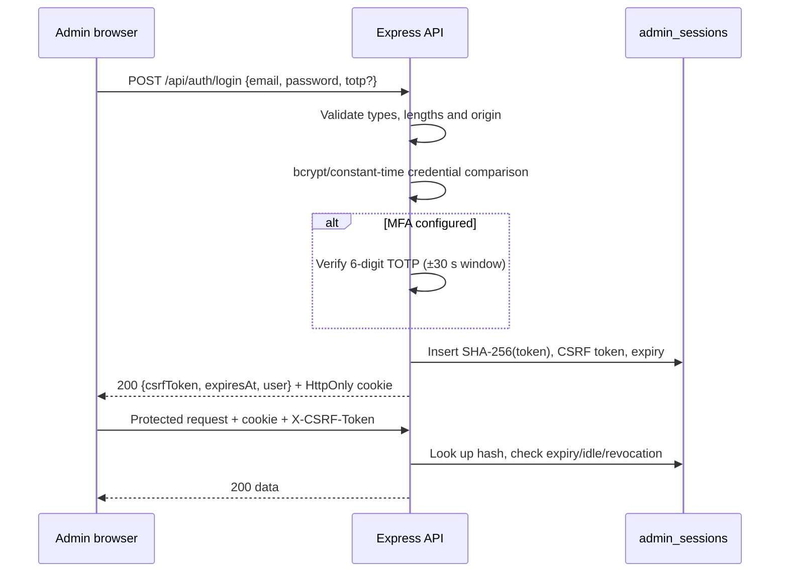

# Authentication and Authorization

**Product:** Mayuresh Kasar Portfolio ("MAYURESH.DEV")
**Document owner:** Mayuresh Kasar
**Status:** Source of truth for admin authentication
**Version:** 2.0
**Last updated:** 2026-11-16
**Code:** `server/utils/adminAuth.js`, `server/utils/sessionConfig.js`, `server/utils/totp.js`, `server/controllers/authController.js`, `server/middleware/authMiddleware.js`, `server/models/sessionModel.js`, `client/src/components/protected/ProtectedRoute.jsx`, `client/src/api/axios.js`
**Related:** [SECURITY_AUDIT.md](./SECURITY_AUDIT.md) · [SECURITY_OPERATIONS.md](./SECURITY_OPERATIONS.md) · [API.md](./API.md) · [ARCHITECTURE.md](./ARCHITECTURE.md)

---

## 1. Model

The application has **exactly one admin identity**, configured entirely
through server environment variables. There is no `users` table, no signup,
no password reset, no invitations, no roles beyond `admin`, and no
per-resource ownership.

| Property | Value |
|---|---|
| Identity source | `ADMIN_EMAIL` + `ADMIN_PASSWORD_HASH` or `ADMIN_PASSWORD` |
| Storage | Server environment only; never the database or browser |
| Password algorithm | bcrypt (preferred) or constant-time SHA-256 comparison for the plain fallback |
| Session | Opaque random token in an HttpOnly cookie |
| Session storage | `admin_sessions` table; only a SHA-256 hash of the token is stored |
| Session lifetime | 120 minutes absolute / 30 minutes idle by default |
| Second factor | Optional TOTP (`ADMIN_TOTP_SECRET`) |
| Browser storage | No auth token. Only a cosmetic `sessionStorage` hint and an in-memory CSRF token |
| Authorization | Server middleware on every private read/mutation |
| Login rate limit | 10 failed logins per 15 minutes per resolved client IP |
| Revocation | Immediate: logout, log out all, expiry, idle timeout, or admin-email change |

This is a deliberate design for a one-owner portfolio. It removes the attack
surface of user registration and password recovery at the cost of requiring
manual credential rotation.

## 2. Environment configuration

### 2.1 Required variables

| Variable | Required | Rules |
|---|---|---|
| `ADMIN_EMAIL` | Yes | Valid email; trimmed/lowercased; must not be `@example.com` or a placeholder |
| `ADMIN_PASSWORD_HASH` | Preferred | Valid bcrypt `$2a$/$2b$/$2y$` hash |
| `ADMIN_PASSWORD` | Fallback | At least 12 characters; not a placeholder/common password; not equal to the email; ≤ 1,024 characters |

If both password forms are set, **the hash wins**. Startup emits a warning
telling the operator to remove the plain value.

### 2.2 Session variables

| Variable | Default | Rules |
|---|---|---|
| `SESSION_TTL_MINUTES` | `120` | Integer 5–1440; absolute lifetime |
| `SESSION_IDLE_MINUTES` | `30` | Integer 5–1440; cannot exceed the absolute lifetime |
| `SESSION_RETENTION_DAYS` | `7` | Integer 1–90; how long expired/revoked rows are kept for audit |
| `SESSION_COOKIE_SECURE` | `true` in production | Boolean; must stay `true` on HTTPS |
| `SESSION_COOKIE_SAMESITE` | `none` in production, `lax` locally | `lax`, `strict` or `none`; `none` requires a Secure cookie |

Because Vercel rewrites `/api` to Render, the session cookie is first-party
on the portfolio origin. `SameSite=lax` is therefore a valid, stricter
production choice. The default `none` also works but is only needed if the
browser ever calls a different site directly.

### 2.3 MFA and retired variables

| Variable | Notes |
|---|---|
| `ADMIN_TOTP_SECRET` | Optional base32 secret. When present, a correct password alone cannot create a session |
| `JWT_SECRET` | **Retired.** Ignored by the code; startup warns if it is still set |
| `JWT_EXPIRES_IN` | **Retired.** Ignored |

Generate an MFA secret with:

```bash
cd server
npm run mfa:setup
```

The script prints a **new** secret, an `otpauth://` URL and the current code.
Store the secret in Render as `ADMIN_TOTP_SECRET`, add the account to an
authenticator app, then restart the API and test the code. The script never
reads or prints an existing configured secret.

### 2.4 Startup validation

`validateAdminAuthConfig()` returns fatal errors and warnings. Fatal examples:

- missing `ADMIN_EMAIL`;
- invalid email format;
- example/placeholder email;
- neither password form set;
- invalid bcrypt hash;
- plain password shorter than 12 characters;
- placeholder/common plain password;
- plain password equal to the email;
- invalid `ADMIN_TOTP_SECRET`.

Warnings include:

- both password forms present;
- plain password in production (hash is safer);
- leading/trailing whitespace in the plain password;
- only one character class in the plain password;
- MFA not configured in production.

`validateEnvironment()` also validates session lifetimes, cookie settings,
origins, ports, database values, AI limits, ClamAV configuration and optional
integration consistency. In production, fatal errors prevent the process from
listening at all.

### 2.5 Generating a bcrypt hash

```bash
cd server
npm run hash-password -- "your-strong-password"
```

The script prints the hash. Put it in the Render environment as
`ADMIN_PASSWORD_HASH` and remove `ADMIN_PASSWORD`. Never commit the hash or
paste it into a document, issue, or chat.

The production service should log:

```text
🔐 Admin login: bcrypt hash; session 120m absolute / 30m idle.
```

## 3. Login flow



### 3.1 Request validation

- `email` and `password` must both be strings.
- Email is trimmed; empty is rejected.
- Password is not trimmed.
- Email max 254 characters; password max 1,024.
- Missing/invalid types return `400` with `Email and password are required.`
- The route is limited to 10 failed attempts per 15 minutes per client IP.

### 3.2 Credential comparison

- Email is normalized with trim + lowercase.
- In hash mode: `bcrypt.compare(password, hash)`.
- In plain mode: SHA-256 both values and `crypto.timingSafeEqual`.
- The email comparison always runs, even when the password is wrong, reducing
  timing leakage.
- A bcrypt error is treated as a mismatch, not a 500.
- If configuration is missing at request time, the response is
  `500 Server configuration error.` without naming the variable.

### 3.3 MFA

When `ADMIN_TOTP_SECRET` is set:

- A correct password without a code returns `401` with `mfaRequired: true`.
- An invalid code returns the same generic `401`, plus `mfaRequired: true`.
- TOTP is SHA-1, 6 digits, 30-second period, with a one-step window for clock
  skew (RFC 6238).
- Codes are compared in constant time and are never logged.
- There are no backup codes. If the authenticator device is lost, the owner
  must update `ADMIN_TOTP_SECRET` in Render and restart. Use the recovery
  checklist in [SECURITY_OPERATIONS.md](./SECURITY_OPERATIONS.md).

### 3.4 Success response

```json
{
  "success": true,
  "message": "Login successful.",
  "csrfToken": "<64 hex characters>",
  "expiresAt": 1760000000000,
  "mfaEnabled": true,
  "user": { "email": "owner@example.com", "role": "admin" }
}
```

No JWT, access token, or refresh token is returned. The session cookie is set
with `HttpOnly`, `Secure` (production), `SameSite`, `Path=/` and no `Domain`.
The cookie name is `__Host-portfolio_session` when Secure and
`portfolio_session` for local HTTP.

## 4. Session design

### 4.1 Database rows

`admin_sessions` stores:

| Column | Meaning |
|---|---|
| `token_hash` | SHA-256 of the cookie token (primary key) |
| `admin_email` | Identity bound at login |
| `csrf_token` | Per-session CSRF value |
| `created_at` | Epoch milliseconds |
| `last_seen_at` | Epoch milliseconds; drives the idle timeout |
| `expires_at` | Epoch milliseconds; absolute expiry |
| `revoked_at` | Epoch milliseconds, `NULL` while active |

A database leak does not expose usable session tokens: only hashes are stored.
Epoch milliseconds avoid MySQL/TiDB timezone differences. Expired and revoked
rows are deleted after `SESSION_RETENTION_DAYS` by startup/6-hour housekeeping.

### 4.2 Request checks

For every protected route, in order:

1. Read the cookie named by the current configuration.
2. Hash the token and look up the row.
3. Reject when missing, revoked, expired, or idle longer than the timeout.
4. Reject when the row's `admin_email` no longer matches `ADMIN_EMAIL`.
5. For non-GET/HEAD/OPTIONS requests, require `X-CSRF-Token` equal to the
   session's CSRF value.
6. Update `last_seen_at` at most once per minute.
7. Attach `req.user` and `req.session`.

A rejected session receives `401` and the cookie is cleared. A missing or
mismatched CSRF token receives `403` with `code: "CSRF_TOKEN_INVALID"`.

### 4.3 CSRF and origin defense

Cookie authentication needs CSRF protection that Bearer tokens did not:

- **Origin/Referer guard** runs globally for every state-changing request.
  The origin must exactly match one entry in `CLIENT_URL` (or a localhost
  origin outside production, or a Vercel preview when explicitly enabled).
- **Per-session CSRF header** is a second, independent check.
- The CSRF token is kept in memory only. It is not written to localStorage.
- The login endpoint itself is origin-checked and rate-limited.

### 4.4 Logout and revocation

| Action | Effect |
|---|---|
| `POST /api/auth/logout` | Sets `revoked_at` on the current row and clears the cookie |
| `POST /api/auth/logout-all` | Sets `revoked_at` on every active row for the admin email |
| Expiry | Row stops working at `expires_at` |
| Idle timeout | Row stops working after `last_seen_at + idle` |
| Admin email change | Every old row is rejected and revoked on next use |
| Password/MFA change | Revoke sessions with log out all (or restart after rotating the secret) |

There is no refresh token. A revoked or expired session cannot be renewed; the
admin signs in again.

## 5. Client behavior

- `client/src/api/axios.js` always uses same-origin `/api`, sends
  `withCredentials: true`, and attaches `X-CSRF-Token` for unsafe methods.
- The CSRF token returned by login is stored in a module variable, not
  localStorage.
- `ProtectedRoute` calls `GET /api/auth/session` once per protected mount. It
  sets the CSRF token and the cosmetic admin-link hint before rendering.
- A `401` clears the in-memory CSRF token and the admin hint. On admin pages it
  redirects to `/admin`; it never reloads the login form after bad credentials.
- `Navbar` shows the Admin link from `sessionStorage` only. That hint is not a
  credential and cannot authorize anything.
- Logout calls the server, then clears local state. "Log out all" calls
  `/api/auth/logout-all`.
- The login form reveals the authenticator field only when the API says
  `mfaRequired`.

## 6. Threat model

| Threat | Control | Residual risk |
|---|---|---|
| Credential stuffing | 10 failed logins/15 min/IP, generic errors, MFA | Distributed IPs; add edge/WAF limits if attacked |
| Password database leak | No password database; env-only credential | Host/env compromise |
| Session database leak | Only SHA-256 token hashes stored | CSRF values are also present but useless without the cookie |
| XSS token theft | No token in JS-readable storage; HttpOnly cookie | XSS could still make authenticated requests in the victim browser |
| CSRF | Origin/Referer guard + per-session header | Same-site subdomain compromise; keep `CLIENT_URL` exact |
| Session replay | HTTPS, short TTL, idle timeout, revocation | Stolen live cookie until revoke/expiry |
| Session fixation | Server generates a new token after login | None material |
| Brute-force MFA | Login rate limit, 30 s codes, one-step window | No per-account lockout; single admin |
| Log leakage | Security events omit email/password/token/CSRF/cookie | Request metadata and IPs are logged |
| Admin email takeover | MFA and strong unique password | Email provider compromise |

## 7. Operations

### 7.1 Verify authentication

```bash
# No cookie -> 401
curl -i https://mk-portfolio-api.onrender.com/api/messages

# Failed login -> 401 and no Set-Cookie
curl -i -X POST https://mk-portfolio-api.onrender.com/api/auth/login \
  -H "Origin: https://mk-portfolio-phi-silk.vercel.app" \
  -H "Content-Type: application/json" \
  -d '{"email":"not-the-admin@example.com","password":"wrong"}'
```

Then sign in through the site and confirm:

- the browser stores a `HttpOnly` `__Host-portfolio_session` cookie;
- localStorage contains no token;
- `GET /api/auth/session` returns a CSRF token;
- a state-changing request without `X-CSRF-Token` returns `403`;
- logout makes the old cookie return `401`.

### 7.2 Rotate the admin password

1. Generate a new bcrypt hash with `npm run hash-password`.
2. Update `ADMIN_PASSWORD_HASH` in Render and remove `ADMIN_PASSWORD`.
3. Deploy/restart.
4. Sign in and use **Log out all** to revoke sessions created with the old
   credential.

### 7.3 Rotate MFA

1. Run `npm run mfa:setup`.
2. Update `ADMIN_TOTP_SECRET` in Render.
3. Restart, add the new account to the authenticator, and test login.
4. Use **Log out all** to revoke existing sessions.

### 7.4 Emergency lockout

1. Set `AI_ENABLED=false` if the paid AI path may be abused.
2. Change `ADMIN_PASSWORD_HASH` and `ADMIN_TOTP_SECRET`, or unset the admin
   password entirely to make login return `500` while the incident is active.
3. Restart Render.
4. Revoke all sessions by deleting active rows or by making the admin email
   temporarily different; after restoring the correct email, use log out all.
5. Follow [INCIDENT_RESPONSE.md](./INCIDENT_RESPONSE.md).

### 7.5 Known limitations

- Rate limits and AI daily counters are in-memory. A restart resets them and a
  multi-instance deployment would not share them. The per-minute limiter is
  still a hard burst control per instance.
- There is no password reset, backup code, or second admin. Recovery requires
  Render environment access.
- There is no refresh token. A session simply expires.
- Session rows are not encrypted at rest beyond the provider's disk encryption;
  they contain no usable bearer token.
- The client hint in `sessionStorage` can be edited but has no security effect.

## 8. Verification checklist

- [ ] `GET /api/messages` without a cookie returns `401`.
- [ ] The login response has no `token` field.
- [ ] A successful login sets an `HttpOnly` cookie and no `Domain` attribute.
- [ ] A failed login sets no cookie.
- [ ] `X-CSRF-Token` is required for POST/PUT/DELETE.
- [ ] `Origin` is required for state changes in production.
- [ ] Logout revokes the session immediately.
- [ ] Log out all revokes every session.
- [ ] An idle or expired session returns `401`.
- [ ] Changing `ADMIN_EMAIL` invalidates old sessions.
- [ ] MFA is required when `ADMIN_TOTP_SECRET` is set.
- [ ] `JWT_SECRET` is absent from Render and startup only warns if present.
- [ ] No token appears in localStorage, sessionStorage, URLs, or logs.
