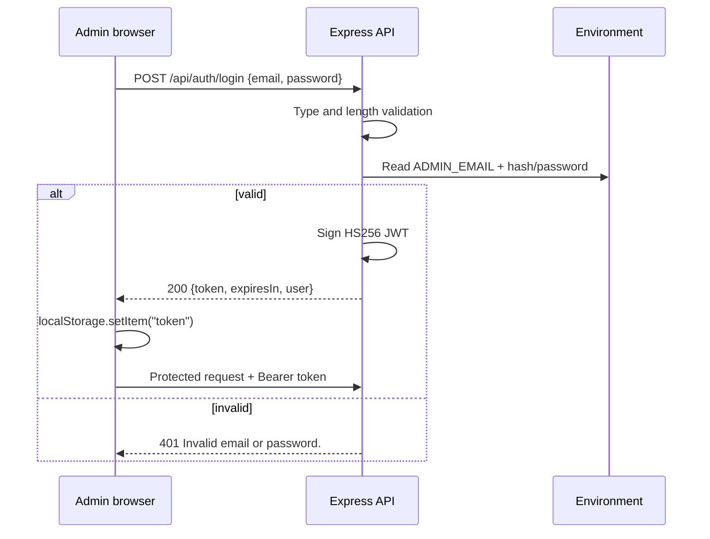

# Authentication and Authorization

**Product:** Mayuresh Kasar Portfolio ("MAYURESH.DEV")
**Document owner:** Mayuresh Kasar
**Status:** Source of truth for admin authentication
**Version:** 1.0
**Last updated:** 2026-11-14
**Code:** `server/utils/adminAuth.js`, `server/controllers/authController.js`, `server/middleware/authMiddleware.js`, `client/src/components/protected/ProtectedRoute.jsx`, `client/src/api/axios.js`
**Related:** [SECURITY_AUDIT.md](./SECURITY_AUDIT.md) · [API.md](./API.md) · [ARCHITECTURE.md](./ARCHITECTURE.md)

---

## 1. Model

The application has **exactly one admin identity**, configured entirely through server environment variables. There is no `users` table, no signup, no password reset, no invitations, no roles beyond `admin`, and no per-resource ownership.

| Property | Value |
|---|---|
| Identity source | `ADMIN_EMAIL` + `ADMIN_PASSWORD_HASH` or `ADMIN_PASSWORD` |
| Storage | Server environment only; never the database or browser |
| Password algorithm | bcrypt (preferred) or constant-time SHA-256 comparison for the plain fallback |
| Session | Stateless JWT, HS256 |
| Token lifetime | `JWT_EXPIRES_IN`, default `12h` |
| Token storage | Browser `localStorage` (current implementation) |
| Authorization | Server middleware on every private read/mutation |
| Rate limit | 10 failed logins per 15 minutes per resolved client IP |

This is a deliberate design for a one-owner portfolio. It removes the attack surface of user registration and password recovery at the cost of requiring manual credential rotation.

## 2. Environment configuration

### 2.1 Required variables

| Variable | Required | Rules |
|---|---|---|
| `ADMIN_EMAIL` | Yes | Valid email; trimmed/lowercased; must not be `@example.com` or a placeholder |
| `ADMIN_PASSWORD_HASH` | Preferred | Valid bcrypt `$2a$/$2b$/$2y$` hash |
| `ADMIN_PASSWORD` | Fallback | At least 12 characters; not a placeholder/common password; not equal to the email; ≤ 1,024 characters |
| `JWT_SECRET` | Yes | Must be present; production validation requires adequate length/entropy |
| `JWT_EXPIRES_IN` | No | Duration string such as `12h`; default `12h` |

If both password forms are set, **the hash wins**. Startup emits a warning telling the operator to remove the plain value.

### 2.2 Startup validation

`validateAdminAuthConfig()` returns fatal errors and warnings. Fatal examples:

- missing `ADMIN_EMAIL`;
- invalid email format;
- example/placeholder email;
- neither password form set;
- invalid bcrypt hash;
- plain password shorter than 12 characters;
- placeholder/common plain password;
- plain password equal to the email.

Warnings include:

- both password forms present;
- plain password in production (hash is safer);
- leading/trailing whitespace in the plain password;
- only one character class in the plain password.

`validateEnvironment()` also validates `JWT_SECRET`, origins, ports, database values, and optional integration consistency. In production, fatal errors prevent the process from listening at all.

### 2.3 Generating a bcrypt hash

```bash
cd server
npm run hash-password -- "your-strong-password"
```

The script prints the hash. Put it in the Render environment as `ADMIN_PASSWORD_HASH` and remove `ADMIN_PASSWORD`. Never commit the hash or paste it into a document, issue, or chat.

The production service currently logs:

```text
🔐 Admin login: bcrypt hash.
```

That confirms hash mode is active.

## 3. Login flow



### 3.1 Request validation

- `email` and `password` must both be strings.
- Email is trimmed; empty is rejected.
- Password is not trimmed.
- Email max 254 characters; password max 1,024.
- Missing/invalid types return `400` with `Email and password are required.`

### 3.2 Credential comparison

- Email is normalized with trim + lowercase.
- In hash mode: `bcrypt.compare(password, hash)`.
- In plain mode: SHA-256 both values and `crypto.timingSafeEqual`.
- The email comparison always runs, even when the password is wrong, reducing timing leakage.
- A bcrypt error is treated as a mismatch, not a 500.
- If configuration is missing at request time, the response is `500 Server configuration error.` without naming the variable.

### 3.3 Success response

```json
{
  "success": true,
  "message": "Login successful.",
  "token": "<jwt>",
  "expiresIn": "12h",
  "user": {
    "email": "admin@example.com",
    "role": "admin"
  }
}
```

The client stores only the token in `localStorage` and navigates to `/admin/dashboard` with `replace: true`.

### 3.4 Failure behavior

- Bad credentials: `401 { "success": false, "message": "Invalid email or password." }`
- No detail about which field was wrong.
- Failed attempts are logged server-side with the resolved client IP, not the submitted email or password.
- The auth limiter counts failed requests; successful logins are skipped.

## 4. JWT design

### 4.1 Claims and signing

| Claim | Value |
|---|---|
| `sub` | Admin email |
| `email` | Admin email |
| `role` | `admin` |
| `iss` | `portfolio-api` |
| `aud` | `portfolio-admin` |
| `exp` | Now + `JWT_EXPIRES_IN` |
| Algorithm | HS256 only |

The signing secret is `JWT_SECRET`.

### 4.2 Verification

`protect` middleware:

1. Requires `Authorization: Bearer <token>`.
2. Rejects a missing/empty token with `401 Authorization token is required.`
3. Requires `JWT_SECRET` and `ADMIN_EMAIL`; otherwise `500 Server configuration error.`
4. Verifies with `algorithms: ["HS256"]`, issuer `portfolio-api`, audience `portfolio-admin`.
5. Requires `role === "admin"`, and both `email` and `sub` to equal the **current** `ADMIN_EMAIL`.
6. Sets `req.user = { email, role: "admin" }`.
7. Maps `TokenExpiredError` to `401 Authentication token has expired.`
8. Maps `JsonWebTokenError` to `401 Invalid authentication token.`
9. Maps anything else to `401 Authentication failed.`
10. Logs the error only outside production.

Because the token is tied to the current `ADMIN_EMAIL`, changing that variable invalidates every existing token even if `JWT_SECRET` is unchanged. Rotating `JWT_SECRET` also invalidates all tokens.

### 4.3 What is not implemented

- No refresh token.
- No server-side session store or revocation list.
- No logout endpoint. Logout is client-side removal of the token; the token remains valid until expiry if it was copied elsewhere.
- No "remember me".
- No token rotation on privilege change (there are no other privileges).

## 5. Authorization boundaries

| Route group | Access | Enforcement |
|---|---|---|
| Public reads (`GET /api/projects`, `/skills`, `/certificates`, `/system`) | Anyone | No token |
| Contact submit (`POST /api/messages`) | Anyone | Validation + rate limit |
| AI (`POST /api/ai/*`) | Anyone | Validation + rate limit |
| Login (`POST /api/auth/login`) | Anyone | Auth limiter |
| Content mutations (`POST/PUT/DELETE` projects, skills, certificates) | Admin | `protect` |
| Message inbox (`GET /api/messages`) | Admin | `protect` |
| Message delete (`DELETE /api/messages/:id`) | Admin | `protect` |

Client-side protection:

- `ProtectedRoute` checks for a token and redirects to `/admin` if absent.
- This is a UX gate, not a security boundary. Anyone can edit `localStorage`; the server still rejects them.
- Axios attaches the token and clears local auth on `401` (except for the login request so the form error remains visible).

## 6. Why the token is in `localStorage`

Advantages:

- simple, stateless, works with the split Vercel/Render deployment;
- no cookie domain/SameSite complexity;
- no CSRF token needed for the current API because credentials are sent in a header, not a cookie.

Risks:

- any XSS can read the token;
- the token survives a tab close until expiry or logout;
- a compromised dependency or injected script can exfiltrate it.

Current mitigations:

- strict CSP with no `unsafe-eval` and no third-party scripts;
- no `dangerouslySetInnerHTML` for API/AI content;
- short-ish 12-hour expiry;
- API only accepts HS256 with the expected issuer/audience;
- tokens are bound to the current admin email;
- no token is ever logged.

**Approval item A1:** move the token to an HttpOnly, Secure, SameSite cookie. That requires:

- login sets a cookie instead of returning a token;
- Axios uses `withCredentials`;
- CSRF protection (double-submit token or SameSite=Strict plus origin checks);
- logout clears the cookie server-side;
- tests for cross-site request behavior;
- CORS credentials remain restricted to exact origins.

Do not make this change piecemeal; a cookie without CSRF protection can be worse than the current header token.

## 7. Client behavior

### Login page (`/admin`)

- Email/password fields with labels.
- Disabled state and "Signing in…" while the request is in flight.
- Generic error banner on failure.
- Back link to the public site.
- `noindex, nofollow` metadata.

### Protected route

- Reads `localStorage.getItem("token")`.
- Redirects to `/admin` when absent.
- Does not validate the token locally; the first API call proves validity.

### Axios interceptor

- Adds `Authorization: Bearer <token>` when a token exists.
- On `401`, removes the token and redirects to `/admin`, except for `/auth/login`.
- Does not retry mutations.
- Allows one retry for idempotent GET requests with no response (cold start).

### Logout

- Removes the token.
- Navigates to `/admin`.
- There is no server call; the old token remains cryptographically valid until expiry.

## 8. Security properties

| Property | Status |
|---|---|
| Credentials never reach the browser | Yes |
| Password stored as bcrypt in production | Yes |
| Plain fallback compared in constant time | Yes |
| Generic login failure message | Yes |
| Login rate limiting | Yes (10 failed / 15 min / IP) |
| JWT algorithm pinning | Yes (HS256 only) |
| Issuer/audience validation | Yes |
| Token bound to current admin email | Yes |
| Short-lived token | 12 h default |
| Server-side authorization on mutations | Yes |
| Admin pages noindex | Yes |
| Token excluded from logs | Yes |
| MFA | No |
| Server-side revocation | No |
| HttpOnly cookie | No |
| Password rotation UI | No |
| Audit log of admin actions | No |

## 9. Operational procedures

### Rotate the admin password

1. Generate a bcrypt hash locally:
   ```bash
   cd server
   npm run hash-password -- "new-strong-password"
   ```
2. Update `ADMIN_PASSWORD_HASH` in Render.
3. Remove `ADMIN_PASSWORD` if present.
4. Save and redeploy (or let Render restart).
5. Verify startup logs show bcrypt hash mode.
6. Sign in with the new password.
7. Confirm an old session token is no longer useful only if `JWT_SECRET` was also rotated; otherwise old tokens remain valid until expiry. Rotate `JWT_SECRET` if immediate invalidation is required.

### Rotate the JWT secret

1. Generate a new random secret.
2. Update `JWT_SECRET` in Render.
3. Redeploy.
4. All existing sessions become invalid; sign in again.

### Compromised admin password

1. Rotate the password hash immediately.
2. Rotate `JWT_SECRET` to invalidate existing tokens.
3. Review Render logs for unexpected admin activity.
4. Review database content and messages for unauthorized changes.
5. Record the incident and notify affected parties if personal data was accessed.

### Lost admin access

Recovery is manual: update `ADMIN_EMAIL`/`ADMIN_PASSWORD_HASH` in Render and redeploy. There is no email reset flow. Keep a secure offline record of the credential and recovery steps.

## 10. Threat model

| Threat | Mitigation | Residual risk |
|---|---|---|
| Credential stuffing | Rate limit, strong password, generic errors | No MFA or IP allowlist |
| Brute force | 10 failed / 15 min, bcrypt cost | Distributed attempts across IPs |
| Timing oracle | Constant-time comparisons, both fields checked | Network noise, bcrypt cost variance |
| JWT forgery | HS256 pinning, strong secret, issuer/audience | Secret compromise |
| Token replay | 12 h expiry, HTTPS, bound to admin email | No revocation list |
| XSS token theft | CSP, no unsafe scripts, text-only AI rendering | Any future XSS becomes credential theft |
| CSRF | Bearer header, not cookies | Would change if cookies are adopted |
| Privilege escalation | No roles; all protected routes require admin | None beyond admin compromise |
| Session fixation | Token issued after successful login, no session ID | None material |
| Log leakage | No tokens/passwords/emails logged on failure | IPs are logged |
| Insider misuse | Single owner | No audit trail |

## 11. Testing

Existing coverage in `server/tests/adminAuth.test.js`:

- plain-text password accepts only exact credentials;
- bcrypt hash path;
- hash precedence when both are set;
- email normalization;
- malformed types rejected;
- placeholder/common password validation;
- missing configuration errors.

Production/CI coverage:

- login succeeds with CI credentials;
- wrong password returns `401`;
- protected endpoint returns `401` without a token;
- authorizes and performs updates with a token;
- login rate limiter is exercised in the Docker stack.

Gaps:

- no test for token expiry (would require time control);
- no test for issuer/audience mismatch;
- no browser-level test that an expired token redirects;
- no automated check that `ADMIN_PASSWORD` is absent from Render.

Add tests with the existing `node:test` style. Do not use real credentials.

## 12. Approval items and recommendations

| ID | Item | Recommendation |
|---|---|---|
| A1 | HttpOnly cookie session | Evaluate; implement with CSRF protection, not as a partial change |
| A2 | MFA for the single admin | Optional; adds recovery complexity |
| A3 | Server-side token revocation | Only needed if cookie/session storage is adopted |
| A4 | Admin audit log | Useful if a second admin or content workflow is added |
| A5 | IP allowlist for `/admin` | Could reduce exposure but breaks mobile/network changes |
| A6 | Password rotation schedule | Define owner policy; rotate on suspicion, not on a rigid timer |

## 13. Rules for contributors

1. Never log or return a password, hash, token, or JWT secret.
2. Never weaken JWT verification (no `algorithms` removal, no `ignoreExpiration`, no audience skip).
3. Never add a client-side authorization check as the only control.
4. Never add signup, password reset, or a users table without an approved product change.
5. Never put `ADMIN_*` or `JWT_*` in a `VITE_*` variable.
6. Any auth change requires tests, an update to this document, and the [SECURITY_AUDIT.md](./SECURITY_AUDIT.md) checklist.
7. Treat a printed token or hash as compromised; rotate it rather than reusing it.
