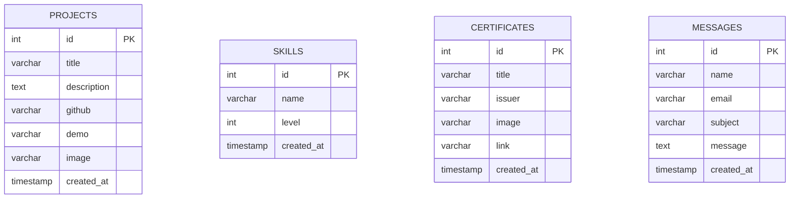

# Database Design

**Product:** Mayuresh Kasar Portfolio ("MAYURESH.DEV")
**Document owner:** Mayuresh Kasar
**Status:** Source of truth for the data model
**Version:** 1.0
**Last updated:** 2026-11-14
**Inputs:** [PRD.md](./PRD.md) · [ARCHITECTURE.md](./ARCHITECTURE.md)
**Implementation:** `server/database/schema.sql`, `server/database/seed.sql`, `server/scripts/database.js`, `server/models/*`

---

## 1. Database technology

| Property | Value |
|---|---|
| Production | TiDB Cloud Serverless, MySQL compatible |
| Local | MySQL 8+ (native or Docker) |
| Driver | `mysql2/promise` connection pool |
| Storage engine | InnoDB |
| Character set | `utf8mb4` |
| Collation | `utf8mb4_unicode_ci` |
| TLS | Enabled in production; TLS 1.2+ with certificate verification |
| Access | Server-side API only; no direct browser database access |
| ORM | None; parameterized SQL in model modules |

### Why this database

- The data is small, relational, and read-heavy.
- TiDB Cloud provides a managed MySQL-compatible endpoint with TLS and a free/serverless tier.
- MySQL 8 keeps local development and Docker close to production.
- Four tables and simple queries do not justify an ORM or a document database.

## 2. Logical model and ER diagram

The schema has **four independent content tables**. There are no foreign keys because:

- projects, skills, certificates, and messages have no parent/child relationship;
- there is one admin and no per-row ownership;
- referential integrity is not needed for standalone rows;
- deleting a project must not cascade into unrelated content.

The absence of relationships is intentional, not an oversight. If future requirements introduce tags, project media galleries, message statuses, or multiple admins, new tables and foreign keys should be designed explicitly.

## 3. Tables and columns

### 3.1 `projects`

| Column | Type | Null | Default | Notes |
|---|---|---|---|---|
| `id` | `INT` | No | Auto-increment | Primary key |
| `title` | `VARCHAR(255)` | No | — | Project title; API max 255 |
| `description` | `TEXT` | No | — | API max 5,000 characters |
| `github` | `VARCHAR(512)` | Yes | `NULL` | Absolute HTTP(S) URL only |
| `demo` | `VARCHAR(512)` | Yes | `NULL` | Absolute HTTP(S) URL only |
| `image` | `VARCHAR(512)` | No | — | Cloudinary secure URL; required on create |
| `created_at` | `TIMESTAMP` | No | `CURRENT_TIMESTAMP` | Display/ordering metadata |

Indexes:

- `PRIMARY KEY (id)`
- `INDEX idx_projects_created (created_at)`

### 3.2 `skills`

| Column | Type | Null | Default | Notes |
|---|---|---|---|---|
| `id` | `INT` | No | Auto-increment | Primary key |
| `name` | `VARCHAR(100)` | No | — | API max 100 |
| `level` | `INT` | No | `80` | 0–100; rounded by API; create defaults to 80 when non-numeric |
| `created_at` | `TIMESTAMP` | No | `CURRENT_TIMESTAMP` | Display/ordering metadata |

Indexes:

- `PRIMARY KEY (id)`
- `INDEX idx_skills_name (name)`

### 3.3 `certificates`

| Column | Type | Null | Default | Notes |
|---|---|---|---|---|
| `id` | `INT` | No | Auto-increment | Primary key |
| `title` | `VARCHAR(255)` | No | — | API max 255 |
| `issuer` | `VARCHAR(255)` | No | `'Unknown'` | API defaults blank issuer to `Unknown` |
| `image` | `VARCHAR(512)` | Yes | `NULL` | Optional Cloudinary URL |
| `link` | `VARCHAR(512)` | Yes | `NULL` | Absolute HTTP(S) credential URL |
| `created_at` | `TIMESTAMP` | No | `CURRENT_TIMESTAMP` | Display/ordering metadata |

Indexes:

- `PRIMARY KEY (id)`
- `INDEX idx_certificates_created (created_at)`

### 3.4 `messages`

| Column | Type | Null | Default | Notes |
|---|---|---|---|---|
| `id` | `INT` | No | Auto-increment | Primary key |
| `name` | `VARCHAR(100)` | No | — | Public sender name |
| `email` | `VARCHAR(150)` | No | — | Public sender email |
| `subject` | `VARCHAR(200)` | No | `'Portfolio Contact Form'` | Added by migration for older databases |
| `message` | `TEXT` | No | — | API max 5,000 characters |
| `created_at` | `TIMESTAMP` | No | `CURRENT_TIMESTAMP` | Inbox timestamp |

Indexes:

- `PRIMARY KEY (id)`
- `INDEX idx_messages_created (created_at)`

There is no read/unread flag, attachment path, status, or ownership column. The current inbox shows all messages newest first; deletion is permanent. Attachments are sent by email when configured and are not stored as message metadata.

## 4. Relationships

| Relationship | Cardinality | Enforcement |
|---|---|---|
| Admin → projects/skills/certificates/messages | One admin manages many rows | Environment-configured admin, not a database FK |
| Project → image | One optional image URL | URL stored as text; Cloudinary owns the bytes |
| Certificate → image | One optional image URL | URL stored as text |
| Message → attachment | Zero or one transient attachment | Forwarded to email; not stored with the row |

No cascading deletes. Deleting a row never deletes a Cloudinary asset automatically.

## 5. Constraints and validation

Database-level constraints are intentionally minimal because TiDB compatibility and application-level validation provide clearer error messages.

| Rule | Enforced by | Behavior |
|---|---|---|
| Primary key uniqueness | Database | Auto-increment |
| Required project title/description/image | API + `NOT NULL` | `400` before insert |
| Project URLs HTTP(S), ≤ 512 | API | `400` |
| Required skill name, ≤ 100 | API + `NOT NULL` | `400` |
| Skill level 0–100 | API | Create: invalid/non-numeric → 80; out of range → `400`. Update: invalid → `400`, out of range clamped |
| Required certificate title, issuer default | API + `NOT NULL` + default | Blank issuer becomes `Unknown` |
| Optional certificate image/link | API + nullable columns | `NULL` accepted |
| Required message name/email/subject/message | API + `NOT NULL` | `400` |
| Email format | API | `400` |
| Message lengths | API | `400` |
| Suggested ID positive integer | API | `400` |
| Explicit public columns | Model queries | No `SELECT *` |

`CHECK` constraints are not used because the API already validates and because TiDB support/behavior is less predictable than MySQL 8. The API is the single validation authority.

## 6. Indexes and real query patterns

### Current queries

| Query | Table | Predicate/order | Index used |
|---|---|---|---|
| List projects | `projects` | `ORDER BY id DESC` | Primary key |
| Get project by ID | `projects` | `WHERE id = ?` | Primary key |
| List skills | `skills` | `ORDER BY id DESC` | Primary key |
| Get skill by ID | `skills` | `WHERE id = ?` | Primary key |
| List certificates | `certificates` | `ORDER BY id DESC` | Primary key |
| Get certificate by ID | `certificates` | `WHERE id = ?` | Primary key |
| List messages | `messages` | `ORDER BY id DESC` | Primary key |
| Insert/update/delete | All | Primary key for update/delete | Primary key |

### Index review

- The primary key is the only index required by current list/detail queries.
- `idx_projects_created`, `idx_certificates_created`, and `idx_messages_created` are not used by the current `ORDER BY id DESC` queries. They add write/storage overhead with no read benefit today.
- `idx_skills_name` is not used by the current list query; it would help exact/prefix name lookups that the API does not expose.
- These indexes are preserved for schema stability. Remove or replace them only with a measured query change and a migration; do not add speculative indexes.

### Future indexes (only when the query exists)

| Future query | Candidate index |
|---|---|
| Messages paginated by newest | Primary key cursor; no extra index |
| Messages filtered by unread/status | `(status, id)` after adding `status` |
| Projects filtered by tag | Join table + `(tag_id, project_id)` |
| Full-text project search | MySQL FULLTEXT or TiDB search feature, after measuring |

## 7. Ownership and authorization

- There is no row-level ownership column. The single admin owns all content and messages.
- Public users may read projects, skills, and certificates; they may not read messages or mutate content.
- Authorization is enforced in the API, not the database:
  - public routes: no token;
  - admin routes: valid JWT with the configured admin email and `admin` role;
  - message inbox and all mutations: `protect` middleware.
- Database credentials belong only to the API. The browser never connects to MySQL/TiDB.
- Row-level security is not used because MySQL/TiDB does not provide PostgreSQL-style RLS and there is only one privileged application role.

### Least-privilege database user

The production application user needs:

- `SELECT`, `INSERT`, `UPDATE`, `DELETE` on the four tables;
- no `CREATE DATABASE`, `DROP`, `ALTER`, or grant privileges at runtime.

Schema/migration commands may use a separate migration credential with DDL rights. Review the actual TiDB user grants before production changes; do not assume the application user is least-privileged until verified.

## 8. Sensitive data handling

| Data | Classification | Handling |
|---|---|---|
| Contact name, email, subject, message | Personal data | Stored in `messages`; visible only to admin; never logged in request bodies; retained until owner deletes |
| Contact attachment | Potentially personal | Forwarded to email; not stored in DB; Cloudinary may retain the uploaded asset until deleted |
| Admin email/password/hash | Secret | Environment only; never in DB or client |
| JWT secret | Secret | Environment only |
| Database credentials | Secret | Environment only |
| Cloudinary/Gemini/Gmail secrets | Secret | Server environment only |
| Public project/skill/certificate content | Public | Readable without auth |
| Telemetry | Public operational data | No hostname, env vars, tokens, or paths |

### Privacy rules

- Do not add message bodies to logs, error messages, or analytics.
- Do not expose sender email in public APIs.
- Do not commit production data dumps or seed files containing real messages.
- The current seed contains portfolio content, not contact messages.
- Define a retention period and deletion owner before claiming a privacy policy. This is an open approval item.

## 9. Migration and seed strategy

### Files

| File | Purpose |
|---|---|
| `schema.sql` | Creates the four tables if missing; no `USE` statement; database-name independent |
| `seed.sql` | Idempotent baseline content: 4 projects, 16 skills, 16 certificates |
| `scripts/database.js` | `setup`, `migrate`, `seed`, `check` commands |
| `database/Dockerfile` | Bakes schema/seed into the local MySQL image for Docker initialization |

### Commands

| Command | What it does | Safe on existing data? |
|---|---|---|
| `npm run db:setup` | Creates the database if permitted and applies `schema.sql` | Yes; `CREATE TABLE IF NOT EXISTS` |
| `npm run db:migrate` | Adds `messages.subject`, makes `certificates.image` nullable, normalizes link defaults, converts tables to utf8mb4, drops legacy `users` | Yes; idempotent checks |
| `npm run db:seed` | Inserts/refreshes the 4/16/16 baseline by primary key | Yes; does not delete rows added later |
| `npm run db:check` | Verifies tables, columns, nullable image, charsets, and prints counts | Read-only |

### Rules

- Never hardcode a database name or `USE` statement in SQL.
- The database name must match `^[A-Za-z0-9_]+$`.
- Production schema changes are forward-only. There is no down migration.
- Back up before destructive DDL or bulk data changes.
- CI applies the SQL to an arbitrary database name (`portfolio_alt`) to prove name independence.
- The seed is baseline content, not a production backup.

### Current production counts

As of 2026-11-14:

| Table | Rows |
|---|---:|
| projects | 4 |
| skills | 16 |
| certificates | 16 |
| messages | Not disclosed; admin-only |

## 10. Backup and recovery

### Current state

- TiDB Cloud is the system of record. Its backup/restore capability depends on the selected plan and must be confirmed in the TiDB console.
- The repository does **not** contain an automated application-level backup job.
- No documented restore drill has been completed.
- Cloudinary assets are outside database backups; losing a URL is recoverable only while the asset remains in Cloudinary.
- The seed file is not a substitute for a backup because it does not include user messages or later admin edits.

### Recommended policy (approval required)

| Item | Recommendation |
|---|---|
| Frequency | Daily logical backup; retain 7–30 days depending on plan |
| Method | TiDB managed backup if available; otherwise scheduled `mysqldump`/`mydumper` from a trusted runner |
| Storage | Encrypted private object storage, separate from the database provider |
| Verification | Monthly restore into a staging database; run `db:check` and compare counts |
| Pre-deploy | Snapshot/export before destructive migrations |
| Retention | Align with the contact-message privacy policy |
| Access | Least-privilege backup credential; no secrets in CI logs |
| Documentation | Record restore steps, owner, and last successful drill date |

### Recovery outline

1. Stop or isolate writes if data corruption is active.
2. Identify the last known-good backup and its timestamp.
3. Restore into a new database first, not over production.
4. Apply forward migrations and run `npm run db:check`.
5. Verify counts and spot-check content through the API.
6. Point the API at the restored database, or promote it after validation.
7. Reconcile Cloudinary assets and any messages received after the backup timestamp.
8. Record the incident and improve the backup cadence if needed.

## 11. Data lifecycle

| Stage | Projects/skills/certificates | Messages |
|---|---|---|
| Create | Admin form + image upload | Public form |
| Read | Public API/page | Admin only |
| Update | Admin dashboard | Not supported |
| Delete | Admin dashboard; Cloudinary asset is not automatically deleted | Admin dashboard; email copy may remain |
| Retention | Until removed | Owner-defined; not yet formalized |
| Backup | Provider backup + recommended dumps | Same; contains personal data |

## 12. Known limitations and approval items

1. **No automated backup/restore drill** — highest data-risk gap.
2. **No message retention policy** — privacy and storage risk.
3. **No Cloudinary cleanup on delete** — orphan assets and quota growth.
4. **No pagination** — the inbox returns all messages; acceptable at current volume, not at scale.
5. **No attachment metadata** — cannot audit or re-download an attachment from the inbox.
6. **No soft delete/audit trail** — deletions are permanent.
7. **Low-value indexes** — review `created_at`/`name` indexes against real query plans.
8. **Database user grants** — confirm the production user is not over-privileged.
9. **No foreign keys** — intentional, but future relational features need explicit design.
10. **TiDB backup plan** — confirm provider-level retention and restoration.

Any change to the schema, retention, or ownership model requires an update to this document and the [API.md](./API.md) contract.
